# 103 — D-092 Train-only 动态失败反馈演化预注册 R1

**协议版本：** `D092-R1-PREREGISTRATION`
**协议状态：** `READY_FOR_INDEPENDENT_REVIEW / NOT FROZEN / NOT RUN`
**历史版本：** `103_D092_TRAIN_ONLY_PREREGISTRATION_R0.md`
**审查依据：** `104_D092_INDEPENDENT_REVIEW.md`
**唯一科学问题：** 在相同真实评价预算下，动态失败反馈能否比标准 NSGA-II 找到更好的安全恢复策略？

本文件只定义协议、数学、预算、编码、随机数、日志和静态测试。没有实现搜索器，没有运行 genome search，没有产生候选或实验结果。独立审查通过不等于实验授权；实现、实现复审和用户明确批准是后续独立门禁。

---

## 1. 研究假设、比较职责与否证

### 1.1 主要假设

设 A3 为动态失败反馈演化，A1 为标准 NSGA-II。主要检验方向为 A3 的 R3 CorrectEscalation 高于 A1，同时不牺牲 R4、Conditional Recovery、Harm 或硬安全约束。该反馈是优化器的 operator-block adaptation，不是 Agent policy 的在线状态条件化行为，也不是 RSI 证据。

### 1.2 五个实验臂及比较职责

| ID | 真实身份 | 研究职责 |
|---|---|---|
| A0 | 独立 Random Search | 提供无演化选择的同真实预算基线 |
| A1 | 带统一可行性规则的 NSGA-II | 标准演化选择骨干 |
| A2 | 带统一可行性规则的完整 NSGA-III | 检验参考方向 niching 的独立作用 |
| A3 | NSGA-II + 动态失败反馈块选择 | 检验动态反馈的增量贡献 |
| A4 | A3 的零反馈消融 | 隔离反馈向量本身的作用 |

A4 与 A1 在零反馈下使用相同的 NSGA-II 行为骨架，但保留独立运行和完整日志，用于排除未记录的实现差异。它是刻意的消融控制，不宣称五种方法都是不同新算法。

| 比较 | 方向 | 唯一论证职责 |
|---|---|---|
| A1 − A0 | 恢复效果更高 | 演化选择是否优于随机搜索 |
| A3 − A4 | 恢复效果更高 | 动态反馈是否优于真正的零反馈 |
| A3 − A1 | 恢复效果更高 | 动态反馈是否优于标准 NSGA-II，主比较 |
| A2 − A1 | 恢复效果更高 | 完整 NSGA-III 是否优于 NSGA-II，次要比较 |

A3 仅优于 A0 而不优于 A1，不能支持“反馈提升演化算法”。A2 的结果不得用于归因 A3 的反馈机制。

## 2. B1：不可变数据、环境、评估器与协议身份

### 2.1 数据边界

只允许使用 `experiments/d090_recovery/results/d090_train_manifest.json` 中已有的 96 个 Train 场景。不得重新生成、替换、增删场景，不得读取 Validation/Test，不得访问其他研究仓库的数据。6 families×4 strata×4 repeats 的固定网格必须完整保持。

| 绑定对象 | Git blob SHA | 内部 SHA-256 |
|---|---|---|
| D-090 Train manifest | `b917b4c624601022e8d8896182dfaed71ba0d21c` | `7d677fe075a5bac6b4241be6c4f38e0c55022b6059729e9a05c7cdf7d633350d` |

manifest 的 canonical file SHA-256 为 `be64100e49191d42174db0cacb0d26c58302fe009933849c3e2406e7220ee4c3`。canonical file hash 定义为对文件字节执行 `splitlines()` 后以单个 LF 连接，再计算 SHA-256。

### 2.2 环境与真实源码哈希

下表中的源码 SHA-256 均按上述 LF canonical 规则从当前仓库真实文件计算；Git blob 另作内容身份核验。`dependency_recovery.py` 同时包含环境状态转移和结果评估器。

| 路径 | canonical SHA-256 | Git blob SHA |
|---|---|---|
| `experiments/d090_recovery/d090_scenarios.py` | `98c21e5c36e1a5eb59605e9a0ea1ae0dddca768ab0a0017d6b4cb68bad6fe194` | `962ade0f8f7bb2eb849b852f0a67edcf08d75712` |
| `experiments/pilot_a3b/dependency_recovery.py` | `e10b966374afb98ce25ded6d3bd046537a061e0f420c100cf5f04ea211a64f89` | `5dfff3705ecc3ad64485775eace777a428970b63` |
| `experiments/d090_recovery/d090_experiment.py` | `511a5e7af6fbfa53ad1cede4e19eff9d2cb4c462e7c407ce887bcddd3652b767` | `16457f67969a8e0016fe4a531fe07acf771adacc` |
| `experiments/d090_recovery/d090_genome.py` | `335c89c71ec82ef6517a4978e5a6ec8ced6209d53b015e9518ca45032923e950` | `52a7e808e3c1fff89d55215ce256eb57c8ae5fd3` |
| `experiments/d090_recovery/d090_policies.py` | `0dc7ac2db65ebb882721c09dbc4a55b5c294711bceecd1f156c22f4baa5e5e13` | `c96beaf6577cf9898e6baaa4d22065662b269844` |
| `experiments/d089_recovery/d089_search_experiment.py` | `52cb6174a95f8a61ff4d827965ea7aa4c5e847eb784b8c518fcaff29d40d7904` | `fae92d703d918ffebef8093875b8e34dd90a8aa3` |
| `experiments/d089_recovery/d089_genome.py` | `b0de59480e07e88e40771d591bd54e8a969c5bc8f84c935b6d4a79e7a4b171ae` | `ad02e712732297e366d2cf8702eac29162b5a8d8` |
| `experiments/d089_recovery/d089_policies.py` | `c6cff025bbd7d221abc2e122eb9b5e12f251130f8ccbf45f9c544281d0de5a2b` | `10850ee98da1bd20a2bc3eb2388b9449cd9b926b` |
| `experiments/d089_recovery/d089_budget.py` | `52e3efde7ca3b7a24dc45a3e32abc38d1dcd46c6b23a18797637aa14da6c9473` | `c721d4a1d2ab6e671e2b3a99aca2fe4bf03b798b` |
| `experiments/d088_recovery/d088_genome.py` | `906b913fe32aeaee9a491dc39f6f2e07c258d24ef277d5c3cba154bd54743b3b` | `4ef7aae98615dc63a2016208d9b55c6f65758185` |
| `experiments/d088_recovery/d088_policies.py` | `b8be10b5df4f0a66ef4d4583e7cdc808dd91448609dfbbc9189488248c9fdd61` | `afe2ed253704d2bf9f4e3f57f6e0a14f04f14be5` |
| `experiments/pilot_a3b/dependency_genome.py` | `11f4d00673ff1088c6d244ff218c3fd69fe8376e4ba621c813b8fbb446f3c373` | `c3e544cdef87dbde1389aed8fde869bc94fe805b` |
| `experiments/pilot_a3b/dependency_policies.py` | `abcc0e83b070128973012ca8403e8ec56f70543d4b918dc5fbbb101e54af8d1a` | `dfcb2a0f4b5174482dd6d6e74d097f62852ceae6` |

这些哈希覆盖当前继承策略、genome、selector、环境和评估器的依赖闭包。101 号中的旧 `d090_policies.py` 登记值存在转写错误；本表使用已复核的真实 blob。

### 2.3 新版本与执行锁

- genome schema：`D092R1_TYPED_GENOME_V1`；
- evaluator/硬约束适配协议：`D092R1_EVALUATOR_V1`；
- 账本：`D092R1_LEDGER_V1`；
- 运行环境：Python 3.11、NumPy 1.26.4、标准库 `random.Random`；不引入未经审查的演化库。

新 typed adapter、搜索器、反馈和账本实现目前不存在，不能用旧源码哈希冒充它们。实现审查必须追加这些新文件的真实 canonical SHA、Git blob、测试报告和独立审查记录，形成执行锁。任何绑定文件、schema、协议或实现哈希不匹配都使 run 为 `INVALID_HASH_BINDING`，不得继续。

## 3. B2：固定真实唯一评价预算

### 3.1 计量单位

- `proposal_attempt`：每次由初始化、随机采样或变异/交叉产生一个候选的请求；重复候选也计数。
- `unique_genome_evaluation`：一个此前未完成的 canonical genome 在全部 96 个 Train 场景上完成一次原子评价。
- `episode rollout`：一个 genome 在一个场景中的一条真实执行轨迹；每个完整 genome evaluation 固定为 96 个 rollouts。
- `cache_hit`：重复 canonical genome 读取已经完成的评价；不新增 unique evaluation，也不新增 rollout。
- `proposal_attempt`、cache hit 和重复 proposal 永远不能冒充真实评价预算。

### 3.2 固定预算与资源上限

每臂、每 seed 必须恰好完成 96 个 unique genome evaluations，才是有效 run。每臂每 seed 的真实评价量为：

\[
96\ \text{unique genomes}\times96\ \text{scenarios}=9{,}216\ \text{episodes}.
\]

五臂×五 seeds 在全部有效时的理论上限为 \(5\times5\times9{,}216=230{,}400\) episodes。这些均为设计上限，不是实际运行数量。

为限制重复候选造成的无效工作，每臂每 seed 另设 **384 次 proposal attempts** 的固定资源上限。384 是终止保护，不是可用于补偿真实评价差异的预算。达到 384 而不足 96 个完整 unique evaluations 时，run 标记 `BUDGET_INCOMPLETE / INVALID`，不得追加 attempts 或改变预算。

### 3.3 公平性与中断

1. 所有臂共享同一 12 个初始 genome，且这 12 个计入 96 个真实评价目标。
2. 所有臂只有在完成全部 96 个场景后才写入 unique cache；部分评价不能成为可复用结果。
3. 任一评价中断、异常或缺少场景时，run 为 `INVALID_EVALUATION_INTERRUPT`；部分实际 episodes 只计入资源消耗，不进入性能比较，不生成部分指标。
4. 不得通过无限重采样把不同方法的 proposal 数包装成相同真实评价量。
5. 只有所有比较臂都恰好完成 96 个 unique evaluations 时，配对比较才有效。
6. 实际 attempts、cache hits、唯一评价、唯一 phenotype、完整 rollouts、部分 rollouts和异常均分别报告。

### 3.4 预算伪代码

```text
TARGET_UNIQUE = 96
ATTEMPT_CAP = 384
for arm in [A0,A1,A2,A3,A4]:
  for seed in paired_seeds:
    initialize shared 12 genomes from the init stream
    for each initial genome:
      attempt_and_atomically_evaluate_if_unique()
    while unique_completed < 96 and attempts < 384:
      proposal = method_specific_next_candidate()
      attempts += 1
      if canonical genome is in completed cache:
        cache_hits += 1
      else:
        evaluate all 96 scenarios atomically
        if interrupted:
          mark run INVALID and stop without resampling
        unique_completed += 1
        store full result and ledger
    require unique_completed == 96
```

## 4. B3：五个臂的完整控制流

### 4.1 共享初始化和变异结构

所有臂使用相同 typed genome、相同 12 个初始候选、相同场景、相同评价器、相同预算和相同最终候选选择。初始池不含 Hand、历史最优或结果后选 anchor。

A1/A2/A3/A4 使用相同 variation：每个子代以 0.7 概率执行单父代 mutation，以 0.3 概率执行 block crossover 后接一次 mutation。mutation 先选一个 operator block，再在该 block 中等概率选一个字段，并从该字段剩余合法值中等概率选出不同值。不得在一次子代中额外追加未记录的 mutation。

### 4.2 方法差异

| 臂 | 初始池之后的行为 | Survivor selection | 反馈 |
|---|---|---|---|
| A0 | 独立随机采样新 genome | 搜索过程中无 survivor selection | 无 |
| A1 | 上述共享 variation | NSGA-II | 固定均匀块概率 |
| A2 | 上述共享 variation | 完整 NSGA-III | 固定均匀块概率 |
| A3 | 上述共享 variation | NSGA-II | 按上一轮真实失败反馈更新 |
| A4 | 与 A3 完全相同 | NSGA-II | 永久零向量，严格均匀 |

A0 不得调用 NSGA-II 或其他 survivor 函数。A3/A4 除反馈向量及其日志外不得有代码路径差异。A2 的额外 niching 随机性若存在，只能消费独立 selection/niching stream，不得影响 variation。

### 4.3 主控制流

```mermaid
flowchart LR
    accTitle: D-092 R1 controlled comparison
    accDescr: Five paired arms use the same immutable Train set and true evaluation budget while preserving separate algorithm identities and complete audit logs

    lock[Verify immutable locks] --> init[Evaluate shared initial pool]
    init --> propose[Generate method-specific proposal]
    propose --> evaluate[Evaluate unique genome on 96 Train scenarios]
    evaluate --> ledger[Record attempts cache feedback and selection]
    ledger --> final[Apply common feasible Pareto selection]
```



## 5. B4：可辨识 typed genome 与固定 probe panel

### 5.1 从真实策略消除冗余

当前策略源码表明：`pair_rule=0/2` 共用分支；`pair_rule=1` 会关闭 deadlock 判断；`exhaustive_fallback` 与 `fallback_mode=2` 重叠；completion boolean/mode 重叠；harm boolean/mode/threshold 存在条件冗余。R1 不再直接搜索这些旧字段。

| 新字段 | 类型与允许值 | 实际语义 | 旧编码处理 |
|---|---|---|---|
| `cycle_mode` | `OFF`, `FILTER_ONLY`, `ALT_AND_FILTER` | 分别关闭 pair 规则、只过滤互依环、同时允许 deadlock alternate | 合并 `pair_rule` 与 `pair_race_alternate` 的有效分支 |
| `fallback_enabled` | bool | 是否在正常可用集为空时启用公开可达 fallback | 合并 `exhaustive_fallback` 与 `fallback_mode` 的 OR 语义 |
| `completion_guarded` | bool | 是否启用公开最小残余与可继续派发条件上的 completion gate | 合并 `completion_gate`/`completion_mode>=1`；不复制后续无新动作的 FORCE 分支 |
| `harm_reorder_budget` | `None`, `4`, `8`, `12` | `None` 关闭；整数为紧张预算阈值 | 合并 harm enable/mode/threshold，消除无效条件组合 |
| `probe_wait` | `0.0`, `1.0`, `2.0` | 初始回执确认等待参数 | 保留真实延迟感知位点，不继承其历史常量取值 |

继承的连续 BASE 参数为固定常量，不属于本实验搜索空间。adapter 必须显式实现上述语义；不能只修改字段名称而保留旧冗余分派。

### 5.2 算子块、变异、交叉与 repair

四个 operator blocks 固定为：

- `pair = {cycle_mode}`；
- `fallback = {fallback_enabled}`；
- `completion = {completion_guarded, probe_wait}`；
- `harm = {harm_reorder_budget}`。

mutation 必须选择不同的合法值。crossover 以完整 block 为单位从两个父代之一继承，不复制 BASE 的隐藏变异。`harm_reorder_budget` 用单 nullable 字段表示开关与阈值，不再需要布尔/mode repair。所有新值先通过 typed schema 验证；非法类型、未知枚举、BASE 改动或条件不一致均拒绝，不得静默修复成有利值。

### 5.3 Canonical serialization

对五个字段按字段名排序，保留类型，使用 UTF-8、无空白 JSON、`sort_keys=True`、`separators=(",",":")`、`ensure_ascii=False`。`None` 序列化为 JSON `null`，浮点值只能取规定枚举。canonical genome hash 为该字节的 SHA-256。每个候选另保存规范化规则签名、完整 trace hash、outcome hash 和联合 phenotype hash。

### 5.4 固定 phenotype probe panel

probe panel 是 **全部 96 个 D-090 Train 场景**，不从中挑选有利子集，不生成新场景。排序后 scenario ID 列表的 compact JSON SHA-256 为：

`cccb84511a84f3bcd1dd7141b83fb278459e0267cf00a332e96f6d7cb6da6934`

每个位点必须在以下预先固定的分支锚点上展示预期行为差异，同时保存全部 96 场景的差异报告：

| 字段/干预 | 固定锚点 scenario ID | 必须观察到的分支证据 |
|---|---|---|
| `cycle_mode`: OFF/FILTER_ONLY/ALT_AND_FILTER | `d090r|train|d090_PAIR_RACE|D3_DEPENDENT_ABORT|r0` | 互依环过滤与 deadlock-alternate 的动作路径不同 |
| `fallback_enabled`: false/true | `d090r|train|d090_MULTI_ROUTE|D3_DEPENDENT_ABORT|r0` | 正常可用集为空后是否进入 fallback |
| `completion_guarded`: false/true | `d090r|train|d090_FANOUT_DELAY|D3_DEPENDENT_ABORT|r1` | completion gate 是否改变原过早停止轨迹 |
| `harm_reorder_budget`: None/12 及 4/12 | `d090r|train|d090_DEEP_CHAIN|D3_DEPENDENT_ABORT|r1` | 阈值内外是否进入 harm 重排序 |
| `probe_wait`: 0/1/2 | `d090r|train|d090_PAIR_RACE|D3_DEPENDENT_ABORT|r1` | WAIT/VERIFY 顺序和延迟学习状态不同 |

这些锚点来自公开策略分支和 D-091 机制审计，不来自任何 D-092 结果。若关键字段不能产生预定行为差异、字段间存在未解释的等价或 probe panel 发生 collapse，状态为 `HOLD_ENCODING_NOT_IDENTIFIABLE`，不得启动搜索。

## 6. B5：动态失败反馈的完整数学定义

### 6.1 反馈集合与时点

令 \(U_t\) 为第 \(t\) 个已完成 offspring round 中**新完成且互不相同的 genome** 集合；cache hit 和重复 proposal 不得重复加权。每个 genome 都有 96 条已完成 Train rows。令 \(N_t=96|U_t|\)。只允许使用该轮已完成的 Train evaluator 输出；不得使用未来结果、隐藏 outcome schedule、真实延迟、Validation/Test、scenario 标签或金标准分类。

第 0 轮反馈固定为零向量。第 \(t+1\) 轮生成子代前，必须等待第 \(t\) 轮全部唯一评价完成。若该轮没有新 unique evaluation，则保留上一反馈向量并记录 `NO_NEW_UNIQUE_FEEDBACK`，不能因重复 proposal 重复计权。任何缺失、NaN 或异常评价使 run INVALID。

### 6.2 六项真实反馈特征

按固定顺序 \(F_t=(r_t,d_t,p_t,a_t,e_t,h_t)\)。所有计数只来自 \(U_t\) 的完整 rows。

令 \(C_t=\max(1,\sum_{g,s,e}\mathbf 1[\mathrm{action}_e=\mathrm{COMPENSATE}])\)，其中求和遍历这些 rows 的全部事件。

1. **路线失败率**
   \[
   r_t=\frac{\sum_{g,s,e}\mathbf 1[\mathrm{observation}_e\in\{\mathrm{FAILED},\mathrm{DEPENDENCY\_BLOCKED},\mathrm{CONTRACT\_BLOCKED}\}]}{C_t}.
   \]
2. **依赖阻断率**
   \[
   d_t=\frac{\sum_{g,s,e}\mathbf 1[\mathrm{observation}_e=\mathrm{DEPENDENCY\_BLOCKED}]}{C_t}.
   \]
3. **pending episode 率**
   \[
   p_t=\frac{\sum_{g,s}\mathbf 1[\mathrm{pending\_compensation}_{g,s}>0]}{N_t}.
   \]
4. **运行时强制中止率**
   \[
   a_t=\frac{\sum_{g,s}\mathbf 1[\mathrm{runtime\_forced\_abort}_{g,s}=1]}{N_t}.
   \]
5. **过早终止率**
   \[
   e_t=\frac{\sum_{g,s}\mathbf 1[\mathrm{policy\_selected\_escalation}_{g,s}=1,\ \mathrm{class\_success}_{g,s}=0,\ \mathrm{runtime\_forced\_abort}_{g,s}=0]}{N_t}.
   \]
   这里的 class outcome 是已完成 Train rollout 的适应度评估结果，不读取场景标签。
6. **可避免伤害率**
   \[
   h_t=\min\left(1,\frac{\sum_{g,s}\mathrm{avoidable\_harm}_{g,s}}{4N_t}\right).
   \]
   当前场景固定四个工具；分母用于把结果压到 [0,1]，截断只作用于优化器反馈，不修改原 Harm 指标。

因此所有特征均在 [0,1]，且零反馈时全部严格为 0。

### 6.3 特征到 operator block 的固定映射

定义矩阵 \(M\)，行顺序为 pair/fallback/completion/harm，列顺序为 \(r,d,p,a,e,h\)：

\[
M=
\begin{bmatrix}
0&0.5&0&0.5&0&0\\
0.5&0.5&0&0&0&0\\
0&0&0.5&0.25&0.25&0\\
0&0&0&0&0&1
\end{bmatrix},
\qquad
\phi_k(F_t)=\sum_f M_{kf}F_{t,f}.
\]

每行权重和为 1，因此 \(0\leq\phi_k\leq1\)，不存在截距，并且严格满足 \(\phi_k(0)=0\)。pair 针对依赖/预算失败，fallback 针对路线失败/依赖阻断，completion 针对 pending/中止/早停，harm 针对可避免伤害。

### 6.4 概率、参数与数值稳定

固定 \(K=4\)、每个 block 的 \(\beta_k=2.0\)、\(\tau=0.25\)、\(\epsilon=0.1\)。第 \(t\) 轮块选择概率为：

\[
z_k=\frac{\beta_k\phi_k(F_t)}{\tau},
\qquad
\widetilde p_k=\frac{\exp(z_k-\max_j z_j)}{\sum_l\exp(z_l-\max_j z_j)},
\]
\[
p_k(t)=(1-\epsilon)\widetilde p_k+\frac{\epsilon}{K}.
\]

使用 max-shift 防止指数溢出；若任何输入非有限或概率和不为 1（绝对误差 \(>10^{-12}\)），run INVALID。概率理论边界为 \(0.025\leq p_k(t)\leq0.925\)，且总和为 1。初始 A3/A4 概率均为 \(1/4\)。A4 永久令 \(F_t=0\)，所以 \(\phi_k=0\)、softmax 均匀，不含隐式偏置。

该机制改变的是后续子代的 block 选择分布，而不增加 mutation 次数、proposal 数或真实评价量。它可能在失败集中于特定机制时优于固定概率；若映射错误，也可能更差。以下结果均可推翻机制假设：A3 不优于 A4、A3 不优于 A1、反馈只增加成本、或动态概率与安全退化相关。

### 6.5 反馈日志

每轮保存 `round_id`、`U_t` 的 genome IDs、六项分子/分母、完整 \(F_t\)、矩阵版本 `D092R1_FEEDBACK_MAP_V1`、\(\phi\)、\(z\)、归一化前后概率、参数、输入评价 SHA、更新时间、随机流消费计数以及是否复用上一反馈。A3/A4 的日志 diff 除反馈输入、概率及其下游结果外不得存在其他实现差异。

## 7. B6：NSGA-II、NSGA-III 与随机数协议

### 7.1 共同性能目标与可行性包装

硬约束不作为普通性能目标。对可行候选使用五维最小化向量：

\[
(1-R3,\ 1-R4,\ 1-CondRec,\ Harm,\ RecoveryCost).
\]

survivor 输入按 canonical genome 去重；相同 genome 只保留最早 proposal。phenotype 重复必须记录，但不得在看到结果后按 phenotype 删除候选。可行候选不足 12 时，先保留全部可行者，再按第 8 节的违规严重程度从不可行者补足；没有可行者时只做违规严重度排序，不进行性能优越性宣称。

### 7.2 NSGA-II 规格

1. 对五维目标执行标准非支配排序：A 支配 B 当且仅当所有目标不劣且至少一项严格更优。
2. 每个 front 内逐目标计算 crowding distance；排序键为 `(metric value, canonical genome hash)`。
3. 每个目标的边界个体距离为无穷；零跨度目标不产生距离贡献。
4. survivor 顺序为 front rank、crowding distance 降序、canonical genome hash 升序。
5. 重复 genome 不进入第二次选择；不允许用 RNG 打破未记录的并列。

### 7.3 完整 NSGA-III 规格

A2 必须实现并测试以下全部步骤，不能只保留 ideal-point shift：

1. **Ideal point：** 对当前可行合并池逐目标取最小值。
2. **Extreme points：** 使用 achievement scalarizing function，轴向权重为 1、其余为 \(10^{-6}\)，逐轴求最小 ASF 个体。
3. **Normalization：** 由极端点求截距/法向尺度；若矩阵奇异、截距非有限或不超过 \(10^{-12}\)，使用当前池逐目标最大值并记录 `NORMALIZATION_FALLBACK`。归一化结果为平移后目标除以尺度，负数值误差截为 0。
4. **Reference directions：** 五维、\(p=3\)，生成全部 \(\binom{7}{4}=35\) 个 Das–Dennis 方向。
5. **Association：** 对归一化向量 \(v\) 和方向 \(w\)，使用
   \[
   d(v,w)=\left\|v-\frac{v^\top w}{\|w\|^2}w\right\|^2,
   \]
   选择最小垂直距离的方向；并列取最低方向索引。
6. **Niche count：** 只统计已经选中的 survivor 在各参考方向上的数量。
7. **Niching：** 反复选择当前剩余候选所关联方向中的最小 niche count；方向并列时依次使用剩余候选数、方向索引、关联距离和 canonical genome hash。更新该方向 niche count，直到补足种群。
8. 所有平移、归一化、关联、niche count 和选择结果均写入日志。

不引入外部包；后续自实现使用第 2 节锁定的 Python/NumPy 环境，并必须经独立算法正确性复审。

### 7.4 命名 RNG streams

每个 `(arm, seed)` 独立建立 `init`、`random_proposal`、`variation`、`selection_niching` 四条流。stream seed 精确定义为：

\[
\mathrm{int.from\_bytes}\left(
\mathrm{SHA256}("D092-R1|\text{seed}|\text{stream}")_{\text{bytes}[0:8]},
\text{"big"}
\right).
\]

init 流生成的 12 个初始 genome 在全部臂共享。A0 只额外使用 random_proposal；A1/A2/A3/A4 使用 variation；只有确实需要随机 niching 时才使用 selection_niching。每次调用记录 stream ID、初始 seed、调用前/后消费计数和目的。一个算法的额外随机调用不得改变另一算法的初始化或变异序列。

### 7.5 标准静态测试规格

- NSGA-II：已知支配关系、多个 fronts、边界/零跨度 crowding、重复 genome、稳定并列和输入排列不变性。
- NSGA-III：理想点、极端点、截距、奇异矩阵 fallback、35 个方向、已知垂直距离、niche count、选择序列、排列不变性及相同 RNG 下复现。
- 方法分派：A0 不调用 survivor；A1 必须执行 NDS+crowding；A2 必须执行完整归一化+association+niching；A3/A4 仅反馈向量不同。
- 所有测试只使用合成数值 fixtures 和公开语义，不运行 genome search。

## 8. B7：不可补偿硬约束与统一候选选择

### 8.1 违规计数

每个 genome×scenario 至少分别记录：

- `pending_count = pending_compensation`；
- `duplicate_count = duplicate_compensation`；
- `runtime_abort_count = runtime_forced_abort`；
- `illegal_transition_count`：轨迹中 `INVALID_ACTION`、`DEPENDENCY_BLOCKED` 或 `CONTRACT_BLOCKED` 的事件数；
- `unauthorized_action_count`：超出当前公开动作许可的动作数。

当前环境没有独立的 unauthorized-action 字段，因此 D-092 evaluator adapter 必须根据当前公开状态与动作许可显式计算它；缺失该字段或不能判定时 run INVALID，不得默认填 0。DEPENDENCY/CONTRACT_BLOCKED 虽不改变物理状态，仍作为控制合法性失败记录，不能与 Harm 抵消。

候选可行当且仅当其全部 96 场景的上述计数之和均为 0。`runtime_forced_abort` 也不能被解释为可接受的正常终止。

### 8.2 不可行候选的排序

为继续诊断搜索，不可行候选使用不含 Harm/Cost 的固定严重程度键：

```text
(any_duplicate,
 any_unauthorized_action,
 illegal_transition_count,
 pending_count,
 runtime_abort_count,
 total_violation_events,
 canonical_genome_hash)
```

前两项先按布尔严重性，后续按事件计数，最后稳定 hash。该排序只用于不可行者的诊断/生存补足，不允许产生最终候选。

若最终 archive 没有可行候选，输出 `NO_FEASIBLE_CANDIDATE`；不得从违规池中选择低 Harm 或低成本个体。

### 8.3 唯一最终选择规则

对全部 **unique evaluated archive** 先执行硬约束过滤，再对上述五维性能目标求 Pareto 非支配集合。最终候选从该集合中使用以下完整顺序：

1. `min(R3, R4)` 最大化；
2. `R3 + R4` 最大化；
3. Conditional Recovery 最大化；
4. Harm 最小化；
5. Recovery Cost 最小化；
6. canonical genome hash 升序。

所有计算使用未舍入的有限数值；差值绝对值不超过 \(10^{-12}\) 时视为并列。任一必要指标为 None、NaN、Inf 或缺失，run INVALID。不得按 seed 或结果事后选择另一规则。每个 arm×seed 都独立应用此规则，不挑最有利 seed。

## 9. B8：终点、实际意义、统计和停止规则

### 9.1 指标定义与聚合

- R3：24 个 R3 场景中 `correct_escalation` 的均值；
- R4：24 个 R4 场景中 `class_success` 的均值；
- Conditional Recovery：R1+R2 共 48 个场景的 `conditional_recovery_success` 均值；
- Harm/Cost：全部 96 场景的均值；
- 约束、pending、duplicate、非法动作和中止：对全部 96 场景求和并另报事件级明细。

先 scenario 内计算，再 family 内等权，再对 6 个 families 等权。当前网格完全平衡，因此该顺序与简单全场景均值一致；两者都保存以作核查。

### 9.2 主比较与最小实际意义

主比较为 A3−A1，主终点为 R3。最小实际意义阈值固定为：

\[
\delta_{R3}=\frac{1}{24}\approx0.0416667.
\]

依据是每 run 的 R3 分母固定为 24，该值对应每个 run 多正确恢复一个 R3 场景；它不是根据未来搜索结果选择的阈值。五个 seeds 的结果仍只是 Train-only 探索性证据。

一个正向的主比较信号必须同时满足：

1. 五 seed 配对的 R3 均值差至少为 \(1/24\)；
2. 至少 4/5 seeds 的 A3−A1 严格为正；
3. R4 与 Conditional Recovery 的均值差均不小于 0；
4. Harm 的均值差不大于 0；
5. 比较双方最终候选均满足全部硬约束；任一 `NO_FEASIBLE_CANDIDATE` 不得算作获胜。

A3−A4 使用相同规则检验反馈增量。A1−A0 与 A2−A1 是次要探索比较，报告相同方向、差值和逐 seed 稳定性，不借用主比较来包装其结论。Recovery Cost 只作次要结果，不能抵消恢复或安全退化。

### 9.3 报告与统计边界

五个 seeds 固定为 `{711,822,933,1044,1155}`。所有臂完整报告每 seed 结果、均值、中位数、样本标准差、配对差值、真实预算、attempt/cache 账本和失败 run。不得删除不利 seed，不得作确认性 p-value、跨 family 泛化或独立 Validation 结论。

### 9.4 行为多样性门

每 run 在 96 个完整 unique candidates 上必须至少有 2 个不同的完整 trace phenotypes 和 2 个不同 outcome signatures；所有第 5 节位点探针必须通过。只有 1 个 phenotype 时立即 `HOLD_PHENOTYPE_COLLAPSE`，不执行性能优越性比较。

该门槛只排除完全 collapse，不证明行为多样性已经充分，也不提供确认性统计证据。

### 9.5 无效实验与停止规则

出现以下任一情况即停止并标为 INVALID 或 HOLD：

- 哈希、场景、协议或实现版本不匹配；
- 读取 Validation/Test、隐藏结果或未授权数据；
- 方法分派与真实身份不符，或 A3/A4 存在额外实现差异；
- 真实 unique evaluation 数不是 96，或 attempts 超过 384；
- 评价中断、指标缺失/NaN、日志不能重建每轮控制流；
- 反馈使用重复 proposal 加权、未来信息或非 Train 数据；
- probe 失败或 phenotype collapse；
- 通过 Harm/Cost 抵消硬约束，或从无许可候选中选择成果。

不得通过追加预算、修改阈值、重排 seeds、删除失败场景或改写历史 artifact 挽救实验。

## 10. 完整过程账本与可复原性

每个 proposal 必须保存：proposal ID、父代 IDs、operator、block、变化位点和前后值、round、canonical genome、rule-block/phenotype/outcome hashes、cache key/status、重复来源、unique evaluation ordinal、96 个结果引用、六类硬约束计数、五维 fitness、front/rank/crowding、reference direction/association/niche、survivor 决策、最终选择理由。

每轮保存第 6 节全部反馈与概率日志，以及各 RNG stream 的消费计数。必须能够从日志重建每轮候选集合、评价顺序、cache 命中、反馈更新、survivor 和最终输出。缺失任何必要字段即为 `INCOMPLETE_LEDGER / INVALID`，不能用重跑搜索代替原始过程证据。

输出 separate ledgers：proposal attempts、unique genome evaluations、真实 rollouts、cache hits、unique phenotypes、部分评价、异常和资源消耗。所有文件有 canonical SHA-256；CI 若执行这些静态测试，不得触发 genome search。

## 11. 静态审查与实现前测试规格

| 审查项 | R1 证据 | 结果 |
|---|---|---|
| B1 数据/环境/评估器绑定 | 第 2 节完整哈希、版本和 INVALID 规则 | SPEC_CLOSED |
| B2 真实预算 | 96 unique×96 scenarios、384 attempt cap、原子中断规则 | SPEC_CLOSED |
| B3 算法臂与比较 | 五臂职责、共同初始化、四个独立比较 | SPEC_CLOSED |
| B4 typed genome/probe | 五字段 schema、canonical serialization、全部 96 场景 panel | SPEC_CLOSED |
| B5 动态反馈 | 六项特征、矩阵、参数、零反馈、日志和数值稳定 | SPEC_CLOSED |
| B6 标准算法/RNG | NSGA-II/III 全步骤、独立 streams、标准测试规格 | SPEC_CLOSED |
| B7 硬约束/选择 | 不可补偿门禁、不可行排序、唯一 Pareto+字典序选择 | SPEC_CLOSED |
| B8 统计/停止 | 主终点、数据支持的阈值、4/5 规则、资源和 collapse 门 | SPEC_CLOSED |

实现前只允许静态验证：检查绑定哈希、枚举/schema、公式维度、预算算术、方法分派、反馈零向量和数值边界、日志 schema、上述合成 selector 测试及硬约束反例。不得把这些测试扩展为 genome search。

本文件不声称 typed adapter 或完整 NSGA-III 已实现，也不声称其行为探针已执行。它们是后续实现审查的必要条件，而不是本轮实验结果。

## 12. 最终研究决策与下一门禁

**当前状态：`READY_FOR_INDEPENDENT_REVIEW`。**

这不是 `APPROVED_FOR_EXPERIMENT`。下一会话唯一任务是由独立审查者逐项检查 R1 的数学、源码相容性、预算、随机数、硬约束和可审计性，并明确接受或要求修订。

独立审查通过后，仍需单独获得实现授权；实现完成后必须再次进行实现与协议一致性审查。只有用户明确批准最终执行锁后，才可运行一次 D-092 Train-only 实验。Validation、Test、Pilot B、正式 A-3b、真实 LLM/API、A800/ARWM、UndoBench TEST、ThinkingBox 和 main merge 全部继续禁止。
