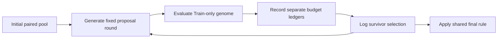

# 103 — D-092 Train-only 搜索可辨识性与反馈演化预注册方案

**日期：** 2026-11-17
**状态：** PROPOSED / NOT FROZEN / NOT RUN
**前置条件：** D-091 独立审计与协议审查完成；本方案本身不授权实现或运行搜索

---

## 1. 研究问题与否证目标

D-092 只回答一个问题：在方法身份真实、搜索轨迹完整、初始候选和评价预算一致、行为表示可辨识的 Train-only 条件下，演化选择或明确的失败反馈变异是否比同预算随机搜索产生更好的安全恢复策略。

以下情况一律不能声称算法提升：

- Random Search 与 NSGA-II 共用搜索分支；
- 仅 genome 数值不同而行为 fingerprint 完全相同；
- 仅报告 best candidate，无法重建 proposal、cache 和 survivor 历史；
- 只改善 Harm 或 Cost，却产生 pending、duplicate、unauthorized action 或其他硬约束违规；
- 在同一批 Train 场景上选择候选后，把选中表现解释为跨 family 泛化；
- 通过增加 proposal、unique evaluation、episode 或决策预算获得优势。

D-090 的证据只支持研究假设，不支持预定 Pair-aware、延迟确认 reservation 或任何联合机制一定有效。

## 2. 方法臂与真实身份

| Arm | 必须实现的搜索行为 | 禁止的替代 |
|---|---|---|
| `random` | 对相同初始池之后的 84 个槽位独立随机采样；无演化选择 | 调用 NSGA-II 分支 |
| `nsga2` | 非支配排序、逐目标拥挤距离、明确的并列处理 | 用方法标签代替行为测试 |
| `nsga3` | 完整理想点、极端点/归一化、参考方向、关联、niche count 与 niching | 将只有理想点平移的简化版称为 canonical |
| `feedback_evo` | 由上一轮 Train-only 反馈更新下一轮变异概率；保留 NSGA-II 选择 | 固定 mutation profile 冒充动态反馈 |
| `feedback_evo/no_feedback` | 相同编码、初始池和预算，固定反馈向量为零 | 同时改变其他机制 |

如保留其他结构机制消融，每个消融只能改变一个预先命名的状态特征或动作规则。不得在看到结果后新增有利臂或删除失败臂。

## 3. 反馈定义与信息边界

反馈只能来自上一轮已完成候选的 Train 评价。令 \(F_g\) 为第 \(g\) 轮的公开失败统计，至少拆分为路线失败、pending 残留、依赖阻断、预算耗尽和过早终止。对变异块 \(k\)，预注册特征映射 \(\phi_k(F_g)\)、系数 \(\beta_k\) 和温度 \(\tau\) 后，使用：

\[
w_k(g)=\exp\left(\frac{\beta_k^\top\phi_k(F_g)}{\tau}\right),
\qquad
P(K_g=k\mid F_g)=\frac{w_k(g)}{\sum_j w_j(g)}.
\]

第一轮使用 \(F_0=\mathbf{0}\)。概率只能在round边界更新，不能读取当前待评价候选的结果、Validation、Test、隐藏 outcome schedule、真实延迟或金标准标签。每一轮保存输入反馈向量、概率向量、公式版本和随机数消费计数。

`no_feedback` 使用同一公式但固定 \(F_g=\mathbf{0}\)，从而保持静态均匀基线。当前具体 \(\beta_k\)、\(\tau\) 和特征映射为 **OPEN**，必须在实现前由独立审查冻结；否则 D-092 不得运行。

## 4. 编码与行为可辨识性门禁

先在 Train-only 的固定 probe panel 上审查规则语义，不使用任何搜索结果选择表示。必须：

1. 明确每个 boolean、mode、threshold 和规则块的有效条件，消除 boolean/mode 重复开关；
2. 为每个候选保存 canonical genome hash、规范化规则 hash、完整 trace hash、outcome hash 和联合 phenotype hash；
3. 报告 variable loci、pairwise Hamming、trace equivalence 和 outcome equivalence；
4. 区分“当前 probe panel 上未观察到行为差异”与“全局无效基因”；
5. 若冻结 probe panel 上仍只有一种 phenotype，或方法臂无法产生可区分搜索轨迹，则 HOLD，不启动功效比较。

Pair-aware completion、delayed-confirmation reservation 和 hard pending gate只能作为候选状态/动作机制。其必要性分别来自 P1 的局部恢复与全局退化、D-090 r2 的共享等待/交错确认路径、P2/P4 的 pending 终止违规；必须分别消融，不能捆绑后宣称每个机制都有贡献。

## 5. 初始池、算子和固定预算

- 初始种群：12 个相同 genome，逐字段保存并在所有演化臂与随机臂间配对。
- 后续提案：7 轮，每轮 12 个，合计 `12 + 7×12 = 96` 个 proposal 槽位。
- 每个 genome 评价全部 96 个 Train 场景，每 episode 最多 24 次决策。
- 唯一 genome evaluation 上限为 96；唯一 rollout 上限为 `96×96 = 9,216/run`。
- 重复 proposal 使用缓存，不新增 rollout，但仍占用 proposal 槽位；不得无限重采样直到凑满 96 个唯一 genome。
- proposal、unique genome、unique phenotype、cache hit 和 rollout 分别记账，不能相互替代。
- 若预算或日志完整性失败，该 run 标为 INVALID，不追加预算挽救。

这里的 7 是实际 offspring round 数，不再是未使用的报告字段。若未来改用其他预算，必须重新审查，不得与 D-090 的历史预算混称。

## 6. 目标、硬约束与统一候选选择

所有方法共用相同 Train evaluator 和六维最小化目标：

1. 硬约束计数；
2. `1 - ConditionalRecoverySuccess`；
3. `1 - R3 CorrectEscalation`；
4. `1 - R4 DamageContainment`；
5. Avoidable Harm；
6. Recovery Cost。

duplicate、pending、unauthorized action 和其他已冻结安全违规均为不可补偿的硬约束。最终选择对所有方法使用同一个规则：硬约束可行 → Pareto 非支配 → 预先冻结的完整字典序（必须显式包含 CondRec、R3、R4、Harm、Cost）→ canonical genome fingerprint。不得从与六维目标不一致的简化 `_best()` 产生最终候选。

选择只使用 Train；不存在 D-092 Validation 或 Test 评价。所有未通过硬约束的候选保留在日志中，但不能成为可行候选。

## 7. 强制过程日志

每个 proposal 至少保存：

- proposal ID、canonical genome、parent IDs、operator、mutation loci 和实际取值变化；
- generation/round、RNG stream ID、调用前和消费后的计数；
- cache key、cache status、重复来源 ID、unique evaluation ordinal；
- phenotype/outcome hash、六维 fitness、硬约束和逐场景结果引用；
- survivor 是否保留、front/rank、crowding distance、reference direction、association 和 niche count；
- 当前反馈向量、动态变异概率和最终选择理由。

缺少这些字段时，对应过程标为 `NOT_AUDITABLE`，不得用重跑搜索结果替代过程证据。

## 8. 种子、统计与停止规则

提议 seeds 为 `{711,822,933,1044,1155}`，所有臂使用配对场景、初始池和 proposal 槽位。主要比较为逐 seed 的 R3、R4、硬约束和 Harm；CondRec、Cost 与 phenotype diversity 同时报告。Train-only 结果只做描述性配对比较，不把少量 seeds 写成确认性显著性证明。

出现以下任一情况立即停止科学功效主张：

- 方法身份或 RNG/初始池不配对；
- phenotype collapse 使算法贡献不可辨识；
- 原始 proposal 或 selection 日志缺失；
- 预算口径被改变；
- 最优候选依赖 Harm/Cost 抵消安全违规；
- 用同一 Train 选中结果宣称独立泛化。

任何后续 Validation 都需要新的 family、独立预注册、功效/MDE 论证、用户批准和数据门禁；本轮不生成、不读取、不申请执行 Validation/Test。

## 9. 当前状态与 OPEN 项

本文件是设计草案，不是已冻结实验。以下项目仍为 **OPEN**：反馈系数与特征映射、规范化行为表示、canonical NSGA-III 参考实现测试、任务预算可达性分层，以及独立协议审查。

D-091 的 CI 和 artifact 只证明只读审计可复现，不授权 D-092。禁止在 D-091 完成前实现或运行上述搜索。
