# 37 — TCAIL 形式化规格 V2.2 Revision R1

**日期：** 2026-11-04

**状态：** CORRECTIVE SPECIFICATION DRAFT / PENDING R2 INDEPENDENT REVIEW / HOLD / IMPLEMENTATION BLOCKED

**唯一仓库：** `yujian777555/kaitibaogao`

**文档性质：** 完整、独立的数学、统计与 EC 接口修订规格；不覆盖 33/34/36 号历史文件

**直接审查依据：** `36_TCAIL_V2_2_INDEPENDENT_REVIEW_R1.md`、`D039_TCAIL_V2_2_INDEPENDENT_REVIEW_DECISION.md`

**历史依据：** `17_TCAIL_FORMAL_SPECIFICATION_V2.md`、`20_TCAIL_V2_1_INDEPENDENT_REVIEW_R1.md`、`21_GOMEA_LINKAGE_AND_NOISY_INTERACTION_RELATED_WORK_AUDIT_R1.md`、`22_TCAIL_LINKAGE_INTERFACE_REVISION_PROPOSAL_R1.md`、`29_PARAMETER_TUNING_AND_EXPERIMENT_GATES_R1.md`、`31_TCAIL_LINKAGE_INTERFACE_INDEPENDENT_REVIEW_R2.md`、`32_TCAIL_V2_2_SPEC_REVISION_TASK_R1.md`、`33_TCAIL_FORMAL_SPECIFICATION_V2_2_DRAFT.md`、`34_TCAIL_V2_2_CHANGELOG_AND_CLOSURE_MATRIX.md`、`35_TCAIL_V2_2_PLANNER_ADDENDUM_R1.md`

> 本文件写完只表示规格草稿已形成，不表示独立审查通过，不表示算法已经实现，不表示任何实验已经运行，不表示统计校准、创新性或 EC 搜索收益成立。TCAIL 继续 HOLD；实现继续阻塞；CI-GOM 与 IMCE-RSI 继续冻结。本文件不授权真实 LLM/DeepSeek API 调用、Phase 0、模型训练或下游演化实验。

---

## 0. 状态、效力与决策边界

### 0.1 当前状态

| 项目 | 本草稿状态 | 含义 |
|---|---|---|
| 数学与统计规格 | DRAFT | 待独立数学、统计和 EC 复审 |
| 实现 | IMPLEMENTATION BLOCKED | 未实现，且本稿不解除阻塞 |
| 参数数值与阈值 | OPEN | 只能由 train/validation 与合成校准冻结 |
| 先验与后验校准 | OPEN | 尚未执行 prior-predictive、SBC 或敏感性分析 |
| M2/M3 鲁棒风险 | OPEN | 已改为各模型自身损失的最坏情形；集合优化和校准待复审 |
| 四阶及以上失配 | OPEN | 已规定压力测试和失败边界，尚未测试 |
| constrained-risk acquisition | OPEN | 已定义 worst-expected fantasy 与 MC 不确定停止；尚未校准或证明收益 |
| Retry 持久账本 | OPEN | 已定义跨轮状态；多轮反例和实际审计未执行 |
| 边际 GLMM practical information | OPEN | 已定义完整 target-rank 与 draw-wise 门；数值校准未执行 |
| missingness-aware FOS | OPEN | 已分离 support coverage、positive density 和 unknown；尚未验证下游价值 |
| 强基线复现与适配 | OPEN | 尚未复现、实现或比较 |
| 独立新颖性 | NOT ESTABLISHED | 组合成熟构件本身不构成创新证据 |
| EC 搜索收益 | NOT ESTABLISHED | 统计图质量不能替代 GOM 搜索证据 |

### 0.2 规格不变量

1. 主要局部对象只有一个：graph `g` 上、objective scale 的条件四格交互 `\Delta_{g,e}`。`q` 是证据概率，`w` 是连续聚类权重，global RMS 是描述/筛查摘要，三者不得互换。
2. 所有边结论必须经过同一组支持、非线性可识别性、实际信息、M2/M3 模型阶数与高阶范围门禁；未决状态不是负边。
3. 最终输出按 `g=(r,parent_id,a)` 索引。每张图只对自己的预注册 pair family 执行鲁棒 BFDR 约束决策，不据此宣称跨 parent 或跨 generation 的全局 FDR。
4. 保守 `max local-null` 只用于约束/资格，不再称为 posterior expected loss。最终集合最小化各模型自身 posterior expected loss 的最坏情形，集合搜索不再默认沿用单模型前缀证明。
5. acquisition 对未来 task-block 四格分别执行 M2/M3 model-specific 生成；每套 fantasy 都重拟合两个推断模型并执行同一鲁棒决策。主规则使用 `max_m E_m[R+λC]`，product-coupled `E[max]` 只作诊断对照。
6. 成本按唯一新增 cell attempt episode-equivalents 记账；base-key ledger 跨轮持久化 attempt、已耗 retry、失败、terminal/exhausted 和剩余额度，任何新周期不得重置。
7. 不支持、不可识别、弱信息、模型敏感和真正实际零边分别编码；FOS 分别记录 support coverage、selected-positive density 和 unknown density，不把缺失填零或用 SLL/MI 偷补。
8. 活动图集合和权重在每个 acquisition cycle 开始前冻结，周期内不得改变；新 parent/generation 只能在下一周期进入，跨期风险不直接作同集合改进解释。
9. 所有阈值、损失、先验尺度和数值容差在 confirmatory test 前冻结。当前未校准的项目一律保持 OPEN，而不是由本稿自行宣布通过。

### 0.3 适用范围与明确失败边界

本稿限定二元模块槽位、声明式合法配置约束、固定版本 evaluator 和有限 context anchor set。主结果类型是程序化成功/失败；Beta 与 Gaussian 仅为预注册次级分析。多类别槽位、自由代码生成、动态工具权限和未冻结 objective scalarization 不在本版范围内。

主模型显式包含至多三阶项。四阶及以上项未被主模型完备表示，因此本版不对“任意高阶响应面均可可靠恢复”作主张。纯四阶、四阶与三阶混合、更高阶混合以及受约束/非均匀背景上的高阶投影均为强制压力场景；触发失配时必须 abstain 或缩小结论范围。M2/M3 一致不能证明四阶及以上项不存在。

---

## 1. 范围与统一符号

### 1.1 配置、合法空间与目标效用

令模块槽位集合为 `[m]={1,\ldots,m}`，配置为

\[
x=(x_1,\ldots,x_m),\qquad x_i\in\{-1,+1\}.
\]

声明式 contract checker 为 `H(x)\in\{0,1\}`，合法空间为

\[
\mathcal X_{\mathrm{valid}}=\{x\in\{-1,+1\}^m:H(x)=1\}.
\]

非法配置不得通过 repair 后静默计入原配置，也不得进入四格差分。若实际系统允许 repair，repair 后的配置是另一个有独立键的配置，原非法 cell 仍为非法。

令 `J(x,a)` 为配置 `x` 在 context anchor `a` 下的真实 objective-scale 条件期望效用。对主 Bernoulli 分析，它是冻结任务参考分布与执行协议下的成功概率。若未来使用多指标 scalarization，权重、归一化和裁剪规则必须在训练前冻结，并与 EC 实际接受/拒绝所用目标一致。

### 1.2 Graph、pair、background 与 anchor

一个局部图由三元组唯一索引：

\[
g=(r,\mathrm{parent\_id},a),
\]

其中 `r` 是预注册的搜索代次或 RSI round，`parent_id` 指向不可变 parent 记录，`a\in\mathcal A` 是冻结的有限 context anchor。当前 parent 配置记为 `x^g`。

一个 pair 为 `e=(i,j)`，`i<j`。该 graph 上的预注册 pair family 为 `\mathcal P_g`；默认包含全部 `\binom m2` 个 pair，任何排除必须在读结果前登记。当前局部背景为

\[
u_{g,e}=x^g_{-ij}.
\]

四个 cell 的符号集合为

\[
\mathcal C=\{++,+-,-+,--\}.
\]

对 `c\in\mathcal C`，`x^c_{g,e}` 表示保持 `u_{g,e}` 不变、只把 `(x_i,x_j)` 替换为 `c` 的配置。Anchor 由部署前可观察特征经冻结映射 `a=A(z_t)` 得到；不得用测试答案、事后轨迹或有利的边结果选择 anchor。

### 1.3 数据、模型与后验符号

| 符号 | 含义 |
|---|---|
| `D` | 当前全部可审计观测及状态、成本元数据 |
| `M\in\{2,3\}` | 二阶或三阶响应模型 |
| `\phi_M(x,a)` | 模型 `M` 在 anchor `a` 的固定效应行向量 |
| `\beta_M` | 固定效应向量 |
| `\nu_M` | 固定效应、随机效应方差、收缩超参数及 likelihood nuisance 的全体参数 |
| `J_M(x,a;\nu_M)` | 模型 `M` 给出的 objective-scale anchor 均值 |
| `\Delta^{(M)}_{g,e}(\nu_M)` | 模型 `M` 下的局部四格 objective contrast |
| `q^{(M)}_{g,e}` | 超过实际意义阈值的后验概率 |
| `\ell^{(M)}_{g,e}=1-q^{(M)}_{g,e}` | local practical-null posterior probability |
| `w^{(M)}_{g,e}` | 供 FOS 聚类的连续权重候选 |
| `\ell_{g,e}^{\mathrm{env}}=1-q_{g,e}^{\mathrm{env}}` | 两模型 local-null 的保守约束包络，不是混合 posterior 概率 |
| `L_{g,M}` / `L_{g,\mathrm{rob}}` | 模型自身 posterior expected loss / 两模型最坏期望损失 |
| `q_{\mathrm{BFDR}}` | 单图保守包络平均 local-null 上限 |
| `\tau_{\mathrm{edge}}` | 单条入选边的最低包络证据门限 |
| `\lambda_{\mathrm{cost}}` | acquisition 中每单位新增 episode-equivalent 的风险折价 |
| `\mathcal G_{\mathrm{act}}^{(r)},\omega_g^{(r)}` | 第 `r` 个 acquisition cycle 冻结的活动图集合与权重 |

所有 posterior functional 必须逐 posterior draw 在 objective scale 上计算。不得先在 link scale 求平均再过 inverse-link，也不得用参数点估计代替 posterior 积分。

---

## 2. 目标与三层对象

### 2.1 第一层：条件 fitness interaction

对 graph `g` 和 pair `e=(i,j)`，真实局部 estimand 为

\[
\Delta_{g,e}
=\Delta_{ij}(x^g_{-ij},a)
=J(x^{++}_{g,e},a)-J(x^{+-}_{g,e},a)
-J(x^{-+}_{g,e},a)+J(x^{--}_{g,e},a).
\]

它回答：在当前 parent 背景和 anchor 下，槽位 `i` 的 objective-scale 效应是否依赖槽位 `j`。负值是合法的负交互，不是非法边或计算错误。四个 cell 必须共享背景、anchor、protocol 和 objective 版本。

模型 `M` 对该同一 estimand 的表达为

\[
\Delta^{(M)}_{g,e}(\nu_M)
=\sum_{c\in\mathcal C}s_cJ_M(x^c_{g,e},a;\nu_M),
\qquad
(s_{++},s_{+-},s_{-+},s_{--})=(1,-1,-1,1).
\]

M2 与 M3 不得分别选择不同的目标尺度、背景或 anchor 后再比较。

### 2.2 第二层：全局 task-conditioned 描述摘要

对全局背景 `u=x_{-ij}`，定义共同合法背景集合

\[
\Omega_{ij}=\{u:H(x^{++}_{ij,u})=H(x^{+-}_{ij,u})
=H(x^{-+}_{ij,u})=H(x^{--}_{ij,u})=1\}.
\]

预注册目标背景分布 `\pi_{\mathrm{target}}(u\mid a)`，共同支持质量为

\[
c_{ij}(a)=P_{u\sim\pi_{\mathrm{target}}}(u\in\Omega_{ij}).
\]

只有 `c_{ij}(a)>0` 时才定义

\[
\pi_{\mathrm{ref}}(u\mid a,i,j)
=\pi_{\mathrm{target}}(u\mid a,u\in\Omega_{ij}),
\]

并计算全局 RMS、平均方向与背景异质性：

\[
S_{ij}(a)=\sqrt{E_{u\sim\pi_{\mathrm{ref}}}
[\Delta_{ij}(u,a)^2]},
\qquad
M_{ij}(a)=E_u[\Delta_{ij}(u,a)],
\qquad
V_{ij}(a)=\operatorname{Var}_u[\Delta_{ij}(u,a)].
\]

若 `c_{ij}(a)=0`，条件分布 `\pi_{\mathrm{ref}}` 无定义；输出状态 `NO_COMMON_SUPPORT`，并令 `S_{ij}(a)=M_{ij}(a)=V_{ij}(a)=\mathrm{NA}`。不得把三者写成数值 0，不得将该项送入任何数值筛查或预算排序，也不得据此声称无边。只有具备正共同支持且通过相应支持门的项才可进入数值筛查。

这些量的 posterior 应从 draw 逐一计算并汇总。`S` 只用于描述、筛查和预算优先级，不直接进入某个 parent 的 BFDR 边集或 FOS 权重。`M\approx0` 不排除背景间符号相反的真实依赖。

在完整、均匀、独立二元背景和 Walsh 展开 `J(x,a)=\sum_S\beta_S(a)\prod_{k\in S}x_k` 下，有

\[
S_{ij}(a)^2=16\sum_{S\supseteq\{i,j\}}\beta_S(a)^2.
\]

该恒等式在受约束或非均匀参考分布下不得沿用；此时若 `c_{ij}(a)>0`，只保留 RMS functional 本身的定义。

### 2.3 第三层：parent/anchor 局部 linkage 后验与 FOS 接口

对每个模型分别定义

\[
q^{(M)}_{g,e}(D)
=P\left(|\Delta^{(M)}_{g,e}(\nu_M)|>\delta_{\mathrm{local}}\mid D\right),
\]

\[
w^{(M)}_{g,e}(D)
=E\left[(|\Delta^{(M)}_{g,e}(\nu_M)|-\delta_{\mathrm{local}})_+\mid D\right],
\]

其中 `(v)_+=\max(v,0)`。对应的局部 practical-null 假设为

\[
H_{0,g,e}:|\Delta_{g,e}|\le\delta_{\mathrm{local}},
\qquad
\ell_{g,e}^{(M)}=P(H_{0,g,e}\mid D,M)=1-q_{g,e}^{(M)}.
\]

同时报告

\[
p^{+,(M)}_{g,e}=P(\Delta^{(M)}_{g,e}>0\mid D),
\qquad
p^{-,(M)}_{g,e}=P(\Delta^{(M)}_{g,e}<0\mid D).
\]

`q` 仅用于证据、资格和边决策；它绝不能直接作为主分析的连续 FOS similarity。主候选连续权重为保守合并后的 `w_{g,e}`，由第 6 节定义。local weighted VIG 是带权重和状态的图，不是 FOS；只有第 7 节的确定性 builder 输出的 mixing subsets 才称为局部 FOS。

---

## 3. Task-block 观测、配对执行与唯一成本账

### 3.1 观测索引

一个 task instance `t` 是不可再分的任务输入实例，具有 task family、来源、split 和可观察上下文。一个 task-block 定义为

\[
b=(\mathrm{block\_id},t_b,\mathrm{protocol\_id},v_{\mathrm{protocol}},s_b),
\]

其中 `s_b` 是 block run seed。`block_id` 全局唯一且不可复用给另一任务或协议。第 `k` 个 evaluation replicate 记为 `(b,k)`，其 episode run seed 由冻结规则从 `s_b` 派生并记录；若外部服务不允许控制 seed，相应字段记为不可控，而不是伪造 seed。

一个局部四格探测设计为

\[
d=(g,e,b,n_{\mathrm{rep}}),
\]

它隐含 parent、pair、background `u_{g,e}` 和 anchor `a`。候选构造时必须一次性确定并冻结 `d.b` 的全部字段：task instance、全局唯一 `block_id`、block run seed、protocol id/version 及其他执行上下文字段。全新 task/block 只能在此时从冻结的 train/validation 分布抽取；已有 task/block 只能在此时选择已有记录。候选构造后，`d` 与 `d.b` 不可变，base-key/成本计划、两套 model-specific fantasy 和实际执行均使用同一个 `d.b`，任何后续阶段不得重新抽取或修改设计。设计的结果不是抽象标量，而是

\[
Y_d=(Y_{d,++},Y_{d,+-},Y_{d,-+},Y_{d,--}),
\]

\[
Y_{d,c}=(Y_{d,c,1},\ldots,Y_{d,c,n_{\mathrm{rep}}}).
\]

主分析中每个 `Y_{d,c,k}\in\{0,1\}`。缺失、基础设施失败或超限 cell 使用显式状态，不得写成数值零。四格执行顺序由 `s_b` 派生的随机排列决定并保存。相同 task instance 上的 replicate 与多个 block 均嵌套于该任务，不冒充新的独立任务样本。

### 3.2 配对与 common random numbers

四格优先复用同一 `b`，从而共享 task instance、protocol 和 block 执行上下文。只有满足以下全部条件才标记严格 common random numbers（CRN）：

1. 环境允许向四个 cell 注入同一外生随机流；
2. 随机变量能按预注册决策点对应，而非仅设置一个名义 seed；
3. 不同配置轨迹的随机数消耗差异不会破坏该对应；
4.  CRN 映射和版本被记录可审计。

仅有相同 API seed、相同 task instance 或相同初始 prompt 不构成严格 CRN。无法严格 CRN 时仍按 task instance/block 配对，并使用第 4 节随机效应；不得把配对观测当作独立样本。Acquisition Monte Carlo 中为减少候选排序噪声而复用随机数称为计算层 common random numbers，与真实 episode 的 CRN 分开报告。

### 3.3 固定 episode 协议与失败规则

每个 episode 使用冻结的模型、system prompt、工具权限、decoding、evaluator、上下文和以下硬上限：

\[
K_{\mathrm{step}},\quad K_{\mathrm{tool}},\quad
K_{\mathrm{token}},\quad K_{\mathrm{time}}.
\]

一个按该协议执行的 episode 记为一个 episode-equivalent。超限时保存已产生资源消耗和部分日志。若业务 objective 预注册“超时即任务失败”，可记 `Y=0`；若属于基础设施失败、评价器失败或不可判定，则记 missing/invalid。两种原因不得混合。重试在同一 replicate 下生成新 attempt 记录并另行计费，原失败记录不得删除。最大重试次数 `K_{\mathrm{retry}}(K_0)` 是**每个 base key 跨全部 proposal、generation 和 round 的终身额度**，不是每次调用的新额度；可重试失败类别和终止规则在采样前冻结。

不同 cap、protocol 或 evaluator 的 episode 不自动等价。Confirmatory 比较固定同一协议；跨协议分析必须另用训练期冻结的加权 reference cost，并同时保留原始计数。

### 3.4 Base key、持久 retry 状态与唯一新增成本

每个 cell replicate 的 base reusable key 不含 attempt，至少包含：

\[
\begin{aligned}
K_0={}&(
\text{canonical configuration/hash},\ \text{task instance},\ \text{anchor},
\text{protocol id/version},\ \text{global unique block\_id},\\
&\text{block run seed/replicate},\ \text{agent model/version},\ \text{evaluator/version},
\text{objective/scalarization version},\ \text{environment version},\ \text{cap policy}).
\end{aligned}
\]

具体 attempt key 为 `K_a=(K_0,attempt,episode_seed(K_0,attempt))`。即使 task、protocol 和 seed 相同，只要 `block_id` 不同就必须使用不同 base key。跨 pair/graph/round 复用只在完整 base key 相同且结果通过完整性校验时允许。

账本对每个 `K_0` 持久保存

\[
\mathcal H(K_0)=(n_{\mathrm{att}},n_{\mathrm{retry,used}},
K_{\mathrm{retry}},K_{\mathrm{remaining}},\mathrm{status},
\mathrm{reusable\_attempt},\mathrm{failure\_history},\mathrm{terminal\_reason}),
\]

其中 `n_att` 包含所有成功、失败、超限和 retry attempt；首次之后的每次执行均消耗一次 retry，故 `n_retry_used=max(0,n_att-1)`，并定义

\[
K_{\mathrm{remaining}}(K_0)
=\max\{0,K_{\mathrm{retry}}(K_0)-n_{\mathrm{retry,used}}(K_0)\}.
\]

`status` 至少区分 `UNSEEN`、`RETRYABLE`、`REUSABLE`、`TERMINAL` 和 `EXHAUSTED`。`TERMINAL` 包含不可重试失败或已有可复用终态；`EXHAUSTED` 表示 retry 额度耗尽。两者均不得因 cache 中没有成功结果而重新获得额度。任何 attempt 后必须原子更新历史 attempt、失败类别、retry 使用量、reusable 引用、terminal/exhausted 状态和下一 attempt 号；fantasy 使用同一状态快照，真实执行与 fantasy 不得采用不同额度规则。

对设计中每个无可复用结果的 base key，定义初始新增指示与本轮允许 attempt 数：

\[
a_0(K_0)=\mathbf 1\{n_{\mathrm{att}}(K_0)=0\},
\qquad
a_{\mathrm{allow}}(K_0)=
\begin{cases}
1+K_{\mathrm{remaining}}(K_0), & \mathrm{status}=UNSEEN,\\
K_{\mathrm{remaining}}(K_0), & \mathrm{status}=RETRYABLE,\\
0, & \mathrm{status}\in\{TERMINAL,EXHAUSTED\}.
\end{cases}
\]

于是

\[
C_{\mathrm{inc}}^0(d)=\sum_{K_0\in d}a_0(K_0),\qquad
C_{\mathrm{need}}(d)=\sum_{K_0\in d}\mathbf 1\{a_{\mathrm{allow}}(K_0)>0\},\qquad
C_{\mathrm{inc}}^{\mathrm{cap}}(d)=\sum_{K_0\in d}a_{\mathrm{allow}}(K_0).
\]

`C_inc^0` 只统计真正从未执行过的 key；已有失败历史的下一次执行是 continuation/retry，`C_inc^0=0` 但仍需计入实际新增成本。若任一必需 cell 为 `TERMINAL/EXHAUSTED` 且无可复用结果，设计返回 `TERMINAL_EXHAUSTED` 并 abstain，不得伪装成 `NO_NEW_INFORMATION` 或重新初始化。

预算过滤首先要求 `C_need≤B_rem`。若 `C_cap>B_rem` 但 `C_need≤B_rem`，只允许把每个活跃缺失 key 的本轮 allowance 降为 1，并明确标记 `BUDGET_LIMITED_NO_RETRY`；已有 key 的这一次执行仍消耗其历史 retry 额度。若 `C_need>B_rem`，返回 `STOP_BUDGET`。实际与 fantasy 总新增成本均满足 `0≤C_inc≤C_cap`，并分别报告 initial-new 与 retry/continuation；不能再使用 `K_retry C_inc^0` 作为跨轮上界。

**可检查边界例：** 若 `K_retry=2`，首轮 initial + 一次 retry 后，`n_att=2`、`n_retry_used=1`、`C_inc^0=0`，下一轮最多只能再执行一次；该次失败后状态为 `EXHAUSTED`，再下一轮 `C_cap=0`，不得重置为两次。首轮全部缓存命中时 `C_need=C_cap=0`；已有 retryable 历史但无缓存命中时，`C_inc^0=0` 而 `C_need=1`。

### 3.5 Full-factorial reference denominator

令 `R_a` 为每个合法配置在 anchor `a` 下的预注册 reference episode 数；该计数只用于成本分母，不把 replicate 称为独立任务样本，则

\[
B_{\mathrm{full}}
=|\mathcal X_{\mathrm{valid}}|\sum_{a\in\mathcal A}R_a.
\]

若所有 `R_a=R`，则 `B_{\mathrm{full}}=|\mathcal X_{\mathrm{valid}}|\,|\mathcal A|\,R`。该分母不按 pair、parent 或四格组合重复计数。5%、10%、20%、40% 预算均以此为 reference，实际曲线使用真实唯一新增 episode-equivalents。

Episodes 不是完整成本。每个方法还必须分别报告 token 数、tool calls、wall-clock、货币成本、失败/超限数和缓存节省量；不能以 episode 数代替货币成本。

---

## 4. 响应模型、随机效应与 nuisance uncertainty

### 4.1 主分析：程序化 Bernoulli GLMM

对 episode `n=(d,c,k)`，主 likelihood 为

\[
Y_n\mid p_n\sim\operatorname{Bernoulli}(p_n),
\]

\[
\operatorname{logit}(p_n)
=\phi_M(x^c_{g,e},a)^\top\beta_M+u_{t_b}+v_b,
\]

\[
u_t\sim N(0,\sigma_T^2),\qquad
v_b\sim N(0,\sigma_B^2),
\]

其中 `u_t` 是 task-instance 随机截距，`v_b` 是嵌套于 task 的 block 随机截距。同一 task 的所有 block 共享 `u_t`；同一 block 的四格和 replicate 共享 `u_t+v_b`。若训练期诊断要求随机斜率，必须另写预注册模型并做敏感性分析，不能在测试后临时加入。

给定 `\nu_M`，模型在 anchor 参考任务分布 `\pi_a` 下的 objective-scale 均值为

\[
J_M(x,a;\nu_M)
=E_{t\sim\pi_a}\,E_{u_t,v_b\mid\nu_M}
\left[\operatorname{logit}^{-1}
(\phi_M(x,a)^\top\beta_M+u_t+v_b)\right].
\]

因此局部 `\Delta` 包含任务分布与随机效应积分，而不是把随机效应设为零后的 link-scale 差分。积分可使用冻结的 quadrature 或 posterior/predictive Monte Carlo；数值误差必须单独报告。

令 `\Theta_M` 包含所有系数、随机效应和超参数。联合 posterior 满足

\[
p(\nu_M\mid D)\propto p(\nu_M)
\prod_t\int p(u_t\mid\nu_M)
\prod_{b:t_b=t}\left[
\int p(v_b\mid\nu_M)
\prod_{n\in b}p(Y_n\mid u_t,v_b,\nu_M)\,dv_b
\right]du_t.
\]

记上式观测部分的乘积积分为边际 GLMM likelihood `L_M^{marg}(D\mid\nu_M)`；其参数只包含固定效应、variance components、收缩和 likelihood nuisance，不包含已积分的 `u_t,v_b`。第 5.5 节的主 Fisher 信息只从该边际观测 likelihood 定义，不使用以随机效应为已知条件的 conditional/complete-data Fisher。

条件于随机效应的 replicate 可以写成乘积，不代表它们边际独立。Posterior 推断必须积分随机效应和 nuisance；cluster bootstrap 不能替代该 likelihood。

### 4.2 Cluster 单位和稳定性分析

Task instance 是 task-level cluster bootstrap 的基本重采样单位：在 task family/anchor 分层内重采样 `t`，保留其全部 block、四格和 replicate，并每次重新拟合 M2/M3 与超参数。Landscape seed 是合成算法比较的外层独立单位；Monte Carlo draw 不是独立任务或独立 landscape。

Bootstrap 用于抽样稳定性、区间诊断和校准，不与原始观测拼接，也不把 bootstrap 频率解释为 posterior probability。Acquisition、posterior 和 cluster 分析必须尊重同一个 task/block 嵌套单位。

### 4.3 Effect、shrinkage 与随机效应先验

对非空模块子集 `S`，令 `\beta_{M,S}` 表示对应 Walsh 固定效应组；截距单独给弱信息先验。本稿冻结的主层级先验形式为

\[
\beta_{M,S}\mid s_{M,|S|},h_{M,S}
\sim N\left(0,(s_{M,|S|}h_{M,S})^2I\right),
\]

\[
s_{M,o}\sim\operatorname{HalfStudentT}(\nu_o,0,s_o^0),
\qquad
h_{M,S}\sim\operatorname{HalfStudentT}(\nu_h,0,1),
\]

\[
\sigma_T\sim\operatorname{HalfStudentT}(\nu_T,0,s_T^0),
\qquad
\sigma_B\sim\operatorname{HalfStudentT}(\nu_B,0,s_B^0).
\]

这些先验的尺度与自由度必须由训练任务的 objective 范围、null/additive prior-predictive 与小样本校准确定；当前数值全部为 OPEN。若校准要求改变先验函数形式，必须生成新规格版本并重新审查，不能在测试后静默替换。固定效应与超参数必须进入同一联合 posterior 或明确的嵌套积分，不得只把经验 Bayes 点估计当作无不确定性真值。

M3 的三阶项及其所有低阶父项均保留在 basis 中，但任何父项系数都可以精确为零或在 posterior 中任意接近零。这里采用“低阶项保留”，不是“低阶系数必须非零”的 strong-heredity 约束，因此 link-scale pure three-way-only 模型可以表示。

### 4.4 次级 Beta 模型

仅当连续结果严格位于 `(0,1)` 时使用

\[
Y_n\sim\operatorname{Beta}(\kappa\mu_n,\kappa(1-\mu_n)),
\qquad
\mu_n=\operatorname{logit}^{-1}
(\phi_M^\top\beta_M+u_t+v_b).
\]

未知 concentration 的对数正态先验固定为

\[
\log\kappa\sim N(m_\kappa,s_\kappa^2),
\]

其中 `m_\kappa,s_\kappa` 仅由训练校准确定，当前数值为 OPEN。令 `\varsigma_M` 表示 shrinkage 超参数，`L_{\mathrm{Beta}}` 表示按第 4.1 节相同 task/block 嵌套积分得到的边际 likelihood，则联合 posterior 为

\[
\begin{aligned}
&p(\beta_M,\kappa,\sigma_T,\sigma_B,\varsigma_M\mid D)\\
&\quad\propto p(\beta_M,\kappa,\sigma_T,\sigma_B,\varsigma_M)\,
L_{\mathrm{Beta}}(D\mid\beta_M,\kappa,\sigma_T,\sigma_B,\varsigma_M),\\
&L_{\mathrm{Beta}}
=\prod_t\int p(u_t)\prod_{b:t_b=t}\left[\int p(v_b)
\prod_{n\in b}\operatorname{Beta}(Y_n;\kappa\mu_n,\kappa(1-\mu_n))dv_b\right]du_t.
\end{aligned}
\]

Acquisition 必须从该联合 posterior 抽取 `\kappa`、生成未来结果并重拟合。若使用 Fisher 近似，必须构造含 `\beta` 与 `\log\kappa` 的联合信息矩阵；对 `\beta` 的有效信息使用

\[
I_{\mathrm{eff}}
=I_{\beta\beta}-I_{\beta,\log\kappa}
I_{\log\kappa,\log\kappa}^{\dagger}I_{\log\kappa,\beta},
\]

并对当前 nuisance posterior 取期望。固定 `\kappa` 时的单项公式只能作为条件特例，不能代入点估计冒充 nuisance uncertainty。

若结果含精确 0 或 1，禁止静默 clipping。必须在训练期预先改用 zero-one-inflated Beta、离散/连续混合模型或回到程序化 Bernoulli 目标；模型切换及其额外参数全部登记。

### 4.5 次级 Gaussian working model

Gaussian 模型仅用于近似连续、边界偏态可接受的结果：

\[
Y_n\sim N(\phi_M^\top\beta_M+u_t+v_b,\sigma^2).
\]

若 `\sigma^2` 未由独立训练协议合法冻结，则固定使用 `\log\sigma\sim N(m_\sigma,s_\sigma^2)`，等价于 `\log\sigma^2\sim N(2m_\sigma,4s_\sigma^2)`，并纳入联合 posterior、预测和 acquisition；`m_\sigma,s_\sigma` 仅由训练校准，当前数值为 OPEN。只有已知固定方差的 Gaussian linear model 才可使用精确共轭 rank-one covariance update；未知方差时必须积分或使用明确近似。Fisher/信息诊断同样使用含 nuisance 的联合矩阵或有效信息。

Beta 与 Gaussian 都是次级敏感性分析，不允许在看到边集或 EC 结果后替换主 Bernoulli 分析。

---

## 5. 非线性可识别性、实际信息与状态机

### 5.1 每个 model basis × anchor 的设计矩阵

对每个 `M\in\{2,3\}` 和每个 anchor `a`，分别构造

\[
X_{\mathrm{legal}}^{(M,a)}
=\{\phi_M(x,a)^\top:x\in\mathcal X_{\mathrm{valid}}\},
\]

以及由当前 anchor `a` 下全部可用观测配置组成的 `X_{\mathrm{obs}}^{(M,a)}`。重复行保留在信息矩阵中，但结构 rank 检查使用可审计的唯一行集合。Cross-anchor  borrowing 只有在线性 predictor basis 和层级模型被明确冻结时才可作次级敏感性；主门禁不得隐式借用其他 anchor 的行。

对 graph `g`、pair `e`，构造四行矩阵

\[
G_{g,e}^{(M)}=
\begin{bmatrix}
\phi_M(x^{++}_{g,e},a)^\top\\
\phi_M(x^{+-}_{g,e},a)^\top\\
\phi_M(x^{-+}_{g,e},a)^\top\\
\phi_M(x^{--}_{g,e},a)^\top
\end{bmatrix}.
\]

线性 contrast `l^\top\beta` 的 row-space 判据只适用于线性 predictor：

\[
r(v,X)=\frac{\|v-X^\dagger Xv\|_2}{\|v\|_2+\epsilon},
\qquad
v\in\operatorname{Row}(X)
\quad\Longleftrightarrow\quad r(v,X)=0.
\]

数值上 `r\le\varepsilon_{\mathrm{rank}}` 只是经校准的代数判据，不等于 objective-scale 非线性 estimand 已识别，也不等于有足够信息量。

### 5.2 Objective-scale 非线性 estimand 的保守充分条件

对 Bernoulli-logistic，先考虑固定 nuisance 的子模型 `p_c=\operatorname{logit}^{-1}(g_c^\top\beta)`。若四个 cell 行分别满足

\[
g_c\in\operatorname{Row}(X_{\mathrm{obs}}^{(M,a)}),
\qquad c\in\mathcal C,
\]

则四个线性 predictor 均可估计，故四个概率及其任意差分可识别。这是保守充分条件，不是必要条件。结构认证对 `X_{\mathrm{legal}}` 执行同一检查；当前数据认证对 `X_{\mathrm{obs}}` 执行。

对于包含随机效应积分的主 estimand，还须认证相关 nuisance 的可识别性，或使用下面的联合 observationally-equivalent 参数条件。四个行向量通过而 nuisance 完全不可区分时，联合 estimand 不得标为已认证。

### 5.3 Estimand-invariance 的充要条件

在固定 nuisance `\vartheta`、不含未积分随机效应的 canonical logistic 子模型中，令所有先验与约束允许的参数集合为 `\mathcal B_{\mathrm{ad}}`。此时观测等价恰由相同的设计上线性 predictor 给出，当前设计下 objective estimand 可识别的充要条件是：对所有 `\beta\in\mathcal B_{\mathrm{ad}}` 和所有满足

\[
X_{\mathrm{obs}}v=0,
\qquad \beta+v\in\mathcal B_{\mathrm{ad}}
\]

的 `v`，均有

\[
\Delta^p(\beta+v,\vartheta)=\Delta^p(\beta,\vartheta).
\]

结构版本将 `X_{\mathrm{obs}}` 换成 `X_{\mathrm{legal}}`，并要求对所有可容许 `\beta,v` 成立。若存在任何一对 observationally equivalent 参数给出不同 `\Delta^p`，即构成不可识别反例。

对未知 nuisance 的完整 GLMM，令 `\nu,\nu'\in\mathcal N_{\mathrm{ad}}` 表示所有可容许参数。联合条件为：只要

\[
p_\nu(Y_{\mathrm{obs}})=p_{\nu'}(Y_{\mathrm{obs}})
\quad\text{对所有可能的 }Y_{\mathrm{obs}},
\]

就必须有 `\Delta(\nu)=\Delta(\nu')`。该条件覆盖固定效应 nullspace 以外的随机效应方差和 likelihood nuisance 混淆。

数值优化未找到反例不能作为结构证明。只有代数恒等式、可审计的精确约束求解、区间证明或明确反例才能改变结构状态；普通数值搜索只能提供“未认证”或反例证据。

### 5.4 非参数共同支持、不可解除状态与 resolvability

非参数共同支持与模型代数可识别性分开记录。令 `L^{\mathrm{loc}}_{g,e}=1` 当且仅当局部四个 cell 全部合法，并定义

\[
c^{\mathrm{loc}}_{g,e}
=P_{t\sim\pi_a}(\text{四个 cell 均可按冻结协议执行}).
\]

若任一 cell 非法或 `c^{\mathrm{loc}}_{g,e}=0`，状态为 `LOCAL_SUPPORT_NOT_RESOLVABLE`；采样不能改变合法性或零支持，永久 abstain，不得输出数值零边。若 `c^{\mathrm{loc}}_{g,e}>0`，但 `0<c^{\mathrm{loc}}_{g,e}<c_{\min}` 或独立 matched task 数不足，则为 `PENDING_LOCAL_SUPPORT`，只能在存在可执行候选时继续采样，预算耗尽则 abstain。

另记录

\[
N^{\mathrm{task}}_{g,e}
=\#\{t:\text{该任务至少有一个四格完整且可用的 matched block}\}.
\]

Confirmatory local VIG 要求 `N^{\mathrm{task}}_{g,e}\ge N_{\min}`；重复 block 和 replicate 不增加该独立任务计数。纯模型外推可进入探索性报告并标 `MODEL_BASED`，但不能绕过主支持门进入 confirmatory FOS。全局 `c_{ij}(a)` 与局部 `c^{\mathrm{loc}}_{g,e}` 分别报告。

对模型 `M`，称当前缺口为 sampling-resolvable，当且仅当以下全部成立：

1. 局部 cell 全合法、`c^{\mathrm{loc}}_{g,e}>0`，且完整合法空间上的结构认证已经完成；
2. 当前 base state 属于 `PENDING_LOCAL_SUPPORT`、`PENDING_SUPPORT` 或 `PRACTICALLY_WEAK_INFORMATION`；
3. 当前合法候选池至少存在一个 `d`，能补足相应的支持、秩或实际信息缺口；
4. 该候选满足 `C_{\mathrm{inc}}^{\mathrm{cap}}(d)\le B_{\mathrm{rem}}`。

因此 `LOCAL_SUPPORT_NOT_RESOLVABLE`、`STRUCTURALLY_NOT_IDENTIFIABLE`、`STRUCTURAL_STATUS_UNCERTIFIED` 永远不算 resolvable；无剩余预算或没有能补缺口的合法候选也不算 resolvable。Resolvability 每轮随候选池、缓存和剩余预算重新计算，不改变永久结构/零支持状态。

### 5.5 Fisher practical information、conditioning 与区间宽度

即使非线性结构可识别，Bernoulli 概率接近 0/1 或任务支持稀少仍可能导致弱信息。主门使用第 4.1 节已积分 task/block 随机效应的边际 GLMM likelihood。令 `\nu_M=(\beta_M,\vartheta_M)`，其中 nuisance `\vartheta_M` 包含 `\sigma_T,\sigma_B` 及其他离散/收缩/likelihood 参数；对固定 `\nu_M`，expected Fisher 定义为

\[
I_M^{\mathrm{marg}}(\nu_M)
=E_{Y\sim p_{\nu_M}^{\mathrm{marg}}}
[-\nabla_{\nu_M}^2\log L_M^{\mathrm{marg}}(Y\mid\nu_M)].
\]

它不包含 latent `u_t,v_b` 的未知实现值，也不得用 conditional/complete-data Fisher 代替。按固定效应 `b` 与 nuisance `n` 分块后，定义

\[
I_M^{\mathrm{marg}}=
\begin{bmatrix}
I_{bb,M}&I_{bn,M}\\
I_{nb,M}&I_{nn,M}
\end{bmatrix},
\qquad
I_{\mathrm{eff},M}
=I_{bb,M}-I_{bn,M}I_{nn,M}^{\dagger}I_{nb,M}.
\]

`I_eff` 是 `p_M×p_M` 的边际 nuisance-adjusted information。每个 posterior draw 必须先满足 `Row(I_bn)⊆Row(I_nn)`、联合边际信息有限且 PSD，且结构门通过；否则不得计算主 Schur 门，输出为 `NA` 并进入弱信息/未认证状态。不得把广义逆的零特征值解释成零方差。

令 `G=G_{g,e}^{(M)}` 为 `4×p_M` 四 cell 行矩阵，`r=rank(G)`，`U` 为 `r×p_M` 的 `Row(G)` 正交行基。本版主门固定要求**完整** `Row(G)` 具有信息，不允许未证明地缩减到某个 estimand-sensitive 子空间。对每个 posterior draw `j=1,\ldots,N_\nu` 分别计算

\[
I_{\mathrm{target},M}^{(j)}
=U\,I_{\mathrm{eff},M}(\nu_{M,j})\,U^\top.
\]

主门必须同时满足

\[
\operatorname{rank}_{\varepsilon_I}(I_{\mathrm{target},M}^{(j)})=r
\quad\text{对所有被使用的 posterior draws }j,
\]

\[
\lambda_{\mathrm{low},M}
=Q_{\alpha_I,j}\{\lambda_{\min}(I_{\mathrm{target},M}^{(j)})\}
\ge\lambda_{\mathrm{info}},
\qquad
\kappa_+(X_{w,M})\le\kappa_{\max},
\qquad
h_{g,e}^{(M)}\le h_{\max},
\qquad
h_{g,e}^{(M)}
=Q_{0.975}(\Delta_{g,e}^{(M)}\mid D)
-Q_{0.025}(\Delta_{g,e}^{(M)}\mid D).
\]

这里使用完整秩与 `λ_min`，不再使用会忽略零方向的 `λ_min^+`。 posterior 平均 `\overline I_{\mathrm{target},M}=E_j[I_{\mathrm{target},M}^{(j)}]` 和 `λ_min` 的完整分布必须报告，但平均矩阵不得单独替代 draw-wise 秩和低分位数门。`\alpha_I`、`\lambda_info`、`\varepsilon_I`、`\kappa_max`、`h_max` 均在训练期校准，当前 OPEN。

若且仅若 `Row(G)\subseteq Row(I_{\mathrm{eff},M})` 且相应 nuisance 条件成立，才可报告

\[
V_{\mathrm{Fisher},g,e}^{(M)}
=G\,I_{\mathrm{eff},M}^{\dagger}G^\top
\]

作为 **Fisher/asymptotic covariance proxy**；它不是自动等于 posterior covariance。主要区间门 `h_{g,e}^{(M)}` 始终由 objective-scale posterior draws 计算，posterior predictor/estimand covariance 另报。`X_{w,M}=W_M^{1/2}X_obs^{(M,a)}` 的正部条件数只作数值诊断，不替代 target-rank 或 posterior 区间。

**可检查边界例：** `I_target=diag(100,0)` 且 `r=2` 时，完整秩门失败，即使 `λ_min^+=100` 也不得通过。若部分 posterior draws 出现零方向，`λ_low` 必须保留该弱信息证据，不能用平均信息掩盖。

### 5.6 每模型 base state、每边 joint state 与后续动作

对每个 `(g,e,M)` 只记录模型自身的 base state `B_{g,e,M}`：局部支持、结构、当前观测支持和实际信息。模型阶数不是单模型维度。每条边另有联合状态 `J_{g,e}=SUMMARIZE_EDGE_STATE(B_{g,e,2},B_{g,e,3})`；`ORDER_CONCORDANT` 和 `ORDER_SUPPORT_MISMATCH` 是联合审查标记，不是任何单模型的 base state。

| 层级 | 状态或标记 | 判定要点 | 后续动作 |
|---|---|---|---|
| 单模型 base | `STRUCTURALLY_NOT_IDENTIFIABLE` | 完整合法设计上存在 estimand-invariance 反例 | 永久 abstain，不采样 |
| 单模型 base | `STRUCTURAL_STATUS_UNCERTIFIED` | 完整合法空间结构证明未完成 | 只做精确认证；采样不能解除 |
| 单模型 base | `LOCAL_SUPPORT_NOT_RESOLVABLE` | 任一局部 cell 非法或 `c_loc=0` | 永久 abstain，不采样 |
| 单模型 base | `PENDING_LOCAL_SUPPORT` | `c_loc>0`，但支持质量或 matched task 数不足 | 仅 resolvable 时采集四格；预算耗尽 abstain |
| 单模型 base | `PENDING_SUPPORT` | 结构已认证，当前观测设计未通过非线性门 | 仅 resolvable 时补支持/秩；预算耗尽 abstain |
| 单模型 base | `PRACTICALLY_WEAK_INFORMATION` | 结构和支持通过，但实际信息门未过 | 仅 resolvable 时补信息；预算耗尽 abstain |
| 单模型 base | `BASE_PASS` | 该模型全部基础门通过 | 等待另一模型；不直接称边已识别 |
| 联合内部枢轴 | `BASE_BOTH_PASS` | 两模型均 `BASE_PASS` | 仅此时进入模型阶数比较 |
| 联合状态 | `MODEL_ORDER_STRUCTURAL_MISMATCH` | 两模型状态不同，且至少一个为结构性不可识别或未认证 | 永久或认证 abstain；不得转为可采样 `MODEL_ORDER_SENSITIVE` |
| 联合状态 | `MODEL_ORDER_SENSITIVE` | 两模型均 `BASE_PASS` 后，方向、效应、证据、权重或边集分歧越阈 | 继续采样并重算两模型；预算耗尽 abstain |
| 联合状态 | `HIGH_ORDER_UNCERTIFIED` | 高阶压力诊断失败或范围无法认证 | 限定或 abstain，M2/M3 一致不能解除 |
| 联合状态 | `DECISION_ELIGIBLE` | 两模型 base 通过、order concordant 且高阶门通过 | 进入逐图鲁棒 BFDR 约束决策 |
| 图级决策状态 | `ROBUST_OPTIMIZATION_UNCERTIFIED` | 鲁棒集合优化没有精确枚举或最优性证书 | `R_g=NA`，停止高置信输出与 acquisition，不选择启发式集合 |
| 周期级决策状态 | `STOP_ACQUISITION_UNCERTAIN` | `S_max` 时仍有收益上界为正但没有下界为正的候选 | 保留不确定状态，不执行候选，不误报非正收益 |

Joint 汇总采用下列穷尽规则，顺序即优先级：

1. 若两模型均为 `BASE_PASS`，返回内部枢轴 `BASE_BOTH_PASS`，再做 provisional BFDR 与模型阶数比较。
2. 若两个 base state 是相同的 `STRUCTURALLY_NOT_IDENTIFIABLE` 或 `STRUCTURAL_STATUS_UNCERTIFIED`，联合状态保持该结构状态。
3. 若两个 base state 不同且至少一个属于上述两种结构状态，联合状态为 `MODEL_ORDER_STRUCTURAL_MISMATCH`。只要任一模型为 `STRUCTURALLY_NOT_IDENTIFIABLE` 就永久 abstain；否则只允许结构认证。采样不得把该冲突改名为敏感或支持不足。
4. 在不触发规则 2–3 时，只要任一模型为 `LOCAL_SUPPORT_NOT_RESOLVABLE`，联合状态即为该状态并永久 abstain，即使另一模型 `BASE_PASS` 也不例外。
5. 其余非双通过组合只可能包含 pending/weak/base-pass。联合状态按 `PENDING_LOCAL_SUPPORT` → `PENDING_SUPPORT` → `PRACTICALLY_WEAK_INFORMATION` 的最早缺口优先级确定。若恰有一个模型未通过且差异仅为可采样支持/信息缺口，可附加 `ORDER_SUPPORT_MISMATCH`；该标记不覆盖永久结构冲突。Joint resolvable 当且仅当所有未通过模型的缺口均按第 5.4 节 resolvable；否则不采样并在预算/候选耗尽时 abstain。
6. 只有规则 1 的两模型共同基础集合 `B_g` 可产生 `ORDER_CONCORDANT` 或 `MODEL_ORDER_SENSITIVE`。其他组合不得计算或宣称 order concordance。

```mermaid
stateDiagram-v2
    accTitle: Base And Joint Edge States
    accDescr: M2 and M3 receive separate base states before deterministic joint summarization; structural conflicts and zero support abstain, while only double base-pass edges enter model-order review.

    [*] --> BaseGateM2
    [*] --> BaseGateM3
    BaseGateM2 --> JointStateSummary
    BaseGateM3 --> JointStateSummary
    JointStateSummary --> StructurallyNotIdentifiable: both certified counterexample
    JointStateSummary --> StructuralStatusUncertified: both uncertified
    JointStateSummary --> ModelOrderStructuralMismatch: structural states differ
    JointStateSummary --> LocalSupportNotResolvable: illegal or zero local support
    JointStateSummary --> PendingLocalSupport: earliest joint support deficit
    JointStateSummary --> PendingSupport: current design deficit
    JointStateSummary --> PracticallyWeakInformation: practical information deficit
    JointStateSummary --> ModelOrderReview: both base pass
    PendingLocalSupport --> JointStateSummary: new matched support
    PendingLocalSupport --> [*]: budget or candidates exhausted
    PendingSupport --> JointStateSummary: new identifying rows
    PendingSupport --> [*]: budget or candidates exhausted
    PracticallyWeakInformation --> JointStateSummary: new information
    PracticallyWeakInformation --> [*]: budget or candidates exhausted
    StructuralStatusUncertified --> JointStateSummary: exact certification complete
    StructuralStatusUncertified --> [*]: certification unavailable
    ModelOrderReview --> ModelOrderSensitive: discrepancy above threshold
    ModelOrderSensitive --> ModelOrderReview: refit after new evidence
    ModelOrderSensitive --> [*]: budget exhausted
    ModelOrderReview --> HighOrderUncertified: higher-order scope fails
    ModelOrderReview --> DecisionEligible: concordant and high-order pass
    StructurallyNotIdentifiable --> [*]: permanent abstain
    ModelOrderStructuralMismatch --> [*]: permanent or certification abstain
    LocalSupportNotResolvable --> [*]: permanent abstain
    HighOrderUncertified --> [*]: restrict or abstain
    DecisionEligible --> RobustOptimizationUncertified: no optimality certificate
    RobustOptimizationUncertified --> [*]: fail closed
    DecisionEligible --> [*]: certified robust BFDR decision
```



---

## 6. M2/M3、保守合并与四阶以上压力边界

### 6.1 两个模型的固定 basis

M2 的线性 predictor basis 包含截距、全部主效应和全部二阶项：

\[
\eta_2(x,a)=\beta_\emptyset^\top\psi(a)
+\sum_i x_i\beta_i^\top\psi(a)
+\sum_{i<j}x_ix_j\beta_{ij}^\top\psi(a).
\]

M3 保留 M2 的全部项并加入全部三阶项：

\[
\eta_3(x,a)=\eta_2(x,a)
+\sum_{i<j<k}x_ix_jx_k\beta_{ijk}^\top\psi(a).
\]

`\psi(a)` 是冻结的 anchor/context 特征。M3 的父项保留是 design-matrix 规则，不要求父项非零，也不要求三阶项非零时才保留父项。两模型使用同样的任务随机效应、参考任务分布、先验校准协议和 objective-scale estimand。

Link-scale pure three-way-only 可由 M3 表示。Objective-scale pure three-way-only 经过 inverse-link 后不一定等价于 link-scale 只有三阶项，因此两类真值必须分别构造，不能宣称一种生成式覆盖另一种。

### 6.2 每个模型的 posterior functional

对两模型分别计算 `q^{(M)}`、`w^{(M)}`、`\ell^{(M)}`、`p^{+,(M)}`、`p^{-,(M)}`、实际平均绝对效应

\[
A_{g,e}^{(M)}=E[|\Delta_{g,e}^{(M)}|\mid D]
\]

以及 posterior 区间。所有 Monte Carlo 汇总同时给 MCSE。不得先计算 link-scale contrast 再通过一个平均概率变换代替上述 posterior functional。

### 6.3 Provisional decisions 与 MODEL_ORDER_SENSITIVE

为避免“模型敏感状态”和“最终边集”循环定义，先由 `SUMMARIZE_EDGE_STATE` 处理所有非双通过组合。只有两模型都为 `BASE_PASS` 的边才进入共同基础集合 `B_g`，并分别用第 8 节同一个 `BFDR_CORE` 得到 provisional edge sets `S_g^{(2)}` 与 `S_g^{(3)}`。单模型未通过时不得直接标记 `MODEL_ORDER_SENSITIVE`；可采样差异只按第 5.6 节进入 pending/weak joint state，并仅在 resolvable 时附加 `ORDER_SUPPORT_MISMATCH`，结构冲突则由 `MODEL_ORDER_STRUCTURAL_MISMATCH` 或明确结构状态处理。

对共同基础集合中的边，满足以下任一条件即触发 `MODEL_ORDER_SENSITIVE`：

1. 方向：`p^{+,(2)}\ge\tau_{\mathrm{dir}}` 且 `p^{-,(3)}\ge\tau_{\mathrm{dir}}`，或反向成立；或
   `|p^{+,(2)}-p^{+,(3)}|>\varepsilon_{\mathrm{dir}}`。
2. 实际效应：
   `|A^{(2)}-A^{(3)}|>\max(\varepsilon_{A,\mathrm{abs}},\varepsilon_{A,\mathrm{rel}}\max(A^{(2)},A^{(3)}))`。
3. 证据：`|q^{(2)}-q^{(3)}|>\varepsilon_q`。
4. 连续权重：`|w^{(2)}-w^{(3)}|>\max(\varepsilon_{w,\mathrm{abs}},\varepsilon_{w,\mathrm{rel}}\max(w^{(2)},w^{(3)}))`。
5. 最终边集：边属于 `S_g^{(2)}\triangle S_g^{(3)}`。主规格冻结 `\varepsilon_{\mathrm{set}}=0`，即任何 provisional 最终入选分歧都触发，不用多数投票掩盖。

上述阈值中除 `\varepsilon_{\mathrm{set}}=0` 外均须由训练/validation 的已知真值、posterior 数值误差和下游 FOS 稳定性校准并冻结；当前为 OPEN。`\delta_{\mathrm{local}}` 不兼任模型差异容差。

### 6.4 约束包络与鲁棒 posterior 风险的严格分工

对未触发敏感状态且两模型均合格的边，定义仅用于**保守约束和资格**的包络

\[
\ell_{g,e}^{\mathrm{env}}=\max(\ell_{g,e}^{(2)},\ell_{g,e}^{(3)}),
\qquad
q_{g,e}^{\mathrm{env}}=1-\ell_{g,e}^{\mathrm{env}}
=\min(q_{g,e}^{(2)},q_{g,e}^{(3)}),
\qquad
w_{g,e}=\min(w_{g,e}^{(2)},w_{g,e}^{(3)}).
\]

`ell_env/q_env` 不是某个混合模型的 posterior local-null/non-null probability，也不得直接代入 FP/FN 项后称为 posterior expected loss 或 worst-case expected loss。`w` 的 min 合并只是 FOS 相似度候选，不参与定义统计风险。

最终决策采用 36 号 R1 的**鲁棒决策路线**：第 8 节用 `ell_env` 定义共同的保守可行集合，但每个模型 `M` 的决策损失只使用该模型自己的 `ell^{(M)}` 与 `q^{(M)}`，再以 `max_M L_M` 定义最坏模型 posterior expected loss。集合优化不再默认沿用单模型 local-null 前缀证明。

第 6.3 节的 provisional `S_g^{(2)}`、`S_g^{(3)}` 仅用于模型敏感性诊断，分别由各模型自身的 local-null、约束和 posterior loss 计算；它们不是最终鲁棒集合。方向和效应仍报告两模型结果及区间包络，不得选择有利模型。

上述约束包络、min-weight 和鲁棒规则的 coverage、actual FDP/FN、regret、优化正确性与功效均须校准；未完成前为 OPEN。模型平均、stacking 或 envelope-score 路线只能作为独立敏感性分析，不得与主鲁棒风险混称。

### 6.5 敏感状态的 acquisition 与解除

`MODEL_ORDER_SENSITIVE` 边进入 unresolved 集合，承担第 8 节的 abstention 风险，并作为 acquisition 的合法目标。候选未来四格结果产生后，必须重拟合 M2/M3、重新执行全部非线性与信息门、重新计算 provisional sets 和全部分歧统计量。

只有同时满足以下条件才解除该状态：两模型均通过基础门；所有方向、实际效应、证据、权重差异不越阈；该边不属于 provisional sets 的对称差； posterior/MCSE 数值误差低于冻结容差；没有高阶未认证标记。不得人工覆盖，也不得通过只报告 M2 或 M3 解除。预算耗尽仍敏感时输出 abstention。

### 6.6 四阶及以上压力测试与失效声明

合成评估必须至少加入：纯四阶项、四阶与二/三阶混合、五阶以上稀疏项、多阶符号翻转，以及受约束/非均匀背景下高阶项向局部 pairwise contrast 投影的场景。小规模上可增加定向 M4 或完整高阶 oracle 作为诊断；大规模上使用预注册的 validation-held-out configuration-task 预测、定向扰动和局部残差诊断，held-out test 不参与门禁校准或状态解除。

高阶诊断必须输出三态 `PASS / FAIL / UNCERTIFIED`：只有预注册诊断全部完成且未越阈时才为 `PASS`；显示局部边方向、效应、权重或集合发生越阈变化时为 `FAIL`；诊断未执行、数值不收敛或范围无法认证时为 `UNCERTIFIED`。`FAIL` 与 `UNCERTIFIED` 均标 `HIGH_ORDER_UNCERTIFIED` 并 abstain，不得把未认证当成通过。即使 `PASS`，也只能声明“在本版已测试阶数和场景内未观察到失配”，不能声明排除了全部四阶以上交互。真实 Agent 上无法完备枚举高阶空间时，该限制必须随图一起输出。

---

## 7. Local q/w、VIG 与 missingness-aware FOS

### 7.1 三个阈值和一种成本折价不得混用

| 参数 | 尺度与作用 | 不参与的角色 |
|---|---|---|
| `\delta_{\mathrm{local}}` | objective utility 尺度；定义实际有意义交互 | 不是 posterior 置信门限 |
| `\tau_{\mathrm{edge}}` | `[0,1]`；限制单条入选边的最低 `q` | 不是聚类权重，也不是 BFDR |
| `\tau_{\mathrm{zero}}` | practical-null 的最大 `q`；冻结 `\tau_{\mathrm{zero}}<\tau_{\mathrm{edge}}` | 不是未入选边的默认阈值 |
| `q_{\mathrm{BFDR}}` | 单图入选集合的平均 local-null 上限 | 不控制跨 graph 全局 FDR |
| `\lambda_{\mathrm{cost}}` | 风险单位/期望总新增 episode-equivalent；acquisition 成本折价 | 不是统计显著性阈值 |

`q` 是资格和证据，不是连续强度。主 FOS 输入是 `w`，global RMS 不是 parent 局部 FOS 的输入。负交互使用同样的 `|\Delta|` 进入 q/w，并通过 `p^+,p^-` 单独报告方向。严格不等式 `\tau_{\mathrm{zero}}<\tau_{\mathrm{edge}}` 与 BFDR 的 `q_{(k)}\ge\tau_{\mathrm{edge}}` 共同保证 selected 与 practical-null 不相交。

### 7.2 权重候选与预注册验证

主候选固定为第 6 节的保守 excess magnitude `w`。它不是已证明最优的相似度。必须在训练/validation 上直接比较：

1. posterior mean absolute contrast：`E[|\Delta|\mid D]`；
2. posterior expected excess：`E[(|\Delta|-\delta_{\mathrm{local}})_+\mid D]`；
3. posterior lower credible bound：`Q_{\alpha_w}((|\Delta|-\delta_{\mathrm{local}})_+\mid D)`；
4. local second-magnitude：`E[\Delta^2\mid D]^{1/2}`；
5. 仅用于反证性消融的 `q`-as-weight。

比较指标包括局部边恢复、权重排序稳定性、FOS 结构、abstention 和同预算 GOM 搜索。选择只能发生在 train/validation；confirmatory 主分析不得换权重。所有未验证结论为 OPEN。

### 7.3 支持、真实零边与缺失编码

最终图对每条预注册 pair 按以下优先级赋且只赋一个类别：

1. `UNRESOLVED`：若 `e\in\mathcal U_g`，即任一支持、结构、信息、模型阶数或高阶门未决，保存具体状态；
2. `SUPPORTED_PRACTICAL_NULL`：否则若 `e\in\mathcal Q_g` 且 `q_e^{\mathrm{env}}\le\tau_{\mathrm{zero}}`，表示支持实际零边；
3. `SELECTED_SUPPORTED`：否则若 `e\in S_g`，必须具有严格为正的有效权重 `w_e>0` 且 `q_e^{\mathrm{env}}\ge\tau_{\mathrm{edge}}`；若入选边不满足该条件，视为决策/数值不一致并 abstain；
4. `NOT_SELECTED`：其余 `e\in\mathcal Q_g`，不自动宣称真实零。

由于冻结 `\tau_{\mathrm{zero}}<\tau_{\mathrm{edge}}` 且鲁棒 BFDR 入选边满足 `q_e^{\mathrm{env}}\ge\tau_{\mathrm{edge}}`，第 2 类不可能进入 `S_g`；上述顺序因此给出互斥且穷尽的分类。若数值结果违反该不变量，必须标为数值错误并 abstain，不能任选一个类别。

主 builder 只把 `SELECTED_SUPPORTED` 视为正相似度边。`SUPPORTED_PRACTICAL_NULL` 是**有支持的零相似度**并进入 support mask；`NOT_SELECTED` 与 `UNRESOLVED` 在 builder 中均为 `NA`，不得填成 0，也不得计入 support coverage 分子。

### 7.4 主 builder：coverage/density 分离的 weighted average-linkage

对当前簇 `A,B`，令全部 cross-pair 集合为 `\mathcal E(A,B)`，`N_{AB}=|A||B|`。分别定义 selected-positive、supported-null 和 builder-unknown 集合 `E_+,E_0,E_?`，以及

\[
n_+=|E_+|,\qquad n_0=|E_0|,\qquad
n_{\mathrm{support}}=n_++n_0,\qquad
n_?=N_{AB}-n_{\mathrm{support}}.
\]

三个不得混用的量为

\[
\rho_{\mathrm{support}}=\frac{n_{\mathrm{support}}}{N_{AB}},\qquad
\rho_+=\frac{n_+}{N_{AB}},\qquad
\rho_?=\frac{n_?}{N_{AB}}=1-\rho_{\mathrm{support}}.
\]

`rho_support` 才是支持覆盖率；`rho_+` 是 selected-positive-edge density；`rho_?` 是未知边比例。`NOT_SELECTED` 和 `UNRESOLVED` 均进入 `n_?`，而 supported practical-null 进入 `n_0`，因此已知零边与未知边不再被同一门槛混淆。

Selected-positive 边具有 `w>0`，supported-null 边具有相似度 0，未知边为 `NA`。当 `n_support>0` 时，缺失感知平均相似度为

\[
\overline w_g(A,B)
=\frac{\sum_{(i,j)\in E_+}w_{g,ij}+\sum_{(i,j)\in E_0}0}
{n_{\mathrm{support}}}.
\]

未知边既不进入分子也不进入分母；known-zero 进入分母。只有 `n_+>0`、`rho_support≥rho_support,min` 且 `rho_+≥rho_+,min` 的簇对可合并。两个阈值独立预注册并做敏感性分析，当前均 OPEN；`rho_+,min=0` 只允许关闭额外正边密度门，不能绕过 `n_+>0` 或支持覆盖门。每次选择 `\overline w` 最大的可合并簇对，创建 `A\cup B`，并记录全部计数、三个密度和未知边 ID。

**可检查边界例：** 对四个 cross pairs，一条 selected 边加三条 unknown 与一条 selected 边加三条 known-zero 具有相同 `rho_+=1/4`，但前者 `rho_support=1/4`、后者为 1；后者的平均相似度还会被 known-zero 正确稀释。若一条 supported 边也没有，`rho_support=0`、相似度为 `NA`，不得合并。

### 7.5 Tie-break、forest 与 safe fallback

相似度在 `\varepsilon_{\mathrm{tie}}` 内视为平局。依次采用：较大 `rho_support`；较大 `rho_+`；较大 `n_support`；较大 `n_+`；最小的有序 cluster-key 对。Cluster-key 为 `(簇内最小槽位编号,簇大小,升序槽位编号元组)`，最后一步完全确定。

若任意两簇都没有满足 coverage/density 双门的正边连接，合并停止并输出 partial forest。已有簇和全部 singleton 保留；孤立顶点和 disconnected components 不得强行连接。若初始没有 selected-positive edge，safe fallback 仅为全 singleton FOS。主 fallback 禁止调用 SLL、MI、随机边或全局 RMS 补边；这些只能作为独立基线或明确标记的 builder sensitivity。

### 7.6 从局部 VIG 到 EC 的接口边界

FOS 由当前 graph 的所有 singleton 与按上述规则生成的合并簇组成，不代表 pair-only mixing，也不自动证明高阶结构被正确捕获。下游若启用 GOM，必须记录 graph ID、图版本、anchor、支持状态、FOS、donor 规则和实际 mixing masks。Parent-specific donor filtering、conditional mating 和高阶重叠 FOS 已有强先例，只能作为待验证接口，不能作为本稿的新颖性声明；本稿不启动 CI-GOM。

---

## 8. Per-graph BFDR 约束边集与一致风险

### 8.1 单图检验族与决策资格

对 graph `g`，检验族严格为预注册 `\mathcal P_g`。令最终可决策集合为

\[
\mathcal Q_g=\{e\in\mathcal P_g:
e\text{ 为 DECISION_ELIGIBLE，且两模型所有基础门均通过}\}.
\]

未进入 `\mathcal Q_g` 的边组成 `\mathcal U_g=\mathcal P_g\setminus\mathcal Q_g`，全部为 unresolved/abstain，不是 negative。只有 `\mathcal Q_g` 中的 local null probability 进入 BFDR 运算。Graph 输出保持 graph-indexed，不在本版聚合成一张跨 parent/generation 图。

### 8.2 保守包络定义的可行集合，而非鲁棒前缀假设

对任意 `S\subseteq\mathcal Q_g`，定义

\[
\widehat{\operatorname{BFDR}}_g^{\mathrm{env}}(S)=
\begin{cases}
|S|^{-1}\sum_{e\in S}\ell_{g,e}^{\mathrm{env}}, & S\ne\varnothing,\\
0, & S=\varnothing.
\end{cases}
\]

共同可行集合族为

\[
\mathcal F_g=\{S\subseteq\mathcal Q_g:
\widehat{\operatorname{BFDR}}_g^{\mathrm{env}}(S)\le q_{\mathrm{BFDR}},
\ q_{g,e}^{\mathrm{env}}\ge\tau_{\mathrm{edge}}\ \forall e\in S\}.
\]

空集始终可行。`ell_env` 在这里是两模型 local-null 的保守约束包络，不被解释为某一 posterior 的精确概率输入。模型 `M` 的 provisional 敏感性分析可在单独使用该模型 `ell^{(M)},q^{(M)}` 时构造相应 `F_g^{(M)}` 并利用单模型前缀性质；该证明不得直接迁移到下述 `max_M` 鲁棒损失。

### 8.3 最终集合最小化最坏模型 posterior expected loss

令 `C_FP,C_FN,C_U≥0` 分别为误选、漏选和 unresolved 的预注册损失。对每个模型分别定义

\[
L_{g,M}(S,D)=
C_{\mathrm{FP}}\sum_{e\in S}\ell_{g,e}^{(M)}
+C_{\mathrm{FN}}\sum_{e\in\mathcal Q_g\setminus S}q_{g,e}^{(M)}
+C_U|\mathcal U_g|.
\]

这才是模型 `M` 自身 posterior 下的 expected decision loss。对 `S\in\mathcal F_g`，鲁棒集合损失为

\[
L_{g,\mathrm{rob}}(S,D)=\max_{M\in\{2,3\}}L_{g,M}(S,D).
\]

令 `L_{g,\mathrm{rob}}^{min}=\min_{S\in\mathcal F_g}L_{g,\mathrm{rob}}(S,D)`，近似最优集合族为

\[
\mathcal S_{\varepsilon,g}=\{S\in\mathcal F_g:
L_{g,\mathrm{rob}}(S,D)\le L_{g,\mathrm{rob}}^{min}+\varepsilon_{\mathrm{risk}}\}.
\]

最终规则在 `S_eps` 中先选 `|S|` 最小者，再按排序后边 ID 元组字典序选唯一集合 `S_g^{rob}`，并报告

\[
R_g(D)=L_{g,\mathrm{rob}}(S_g^{rob},D)
=\max_M L_{g,M}(S_g^{rob},D).
\]

因此风险始终对应实际输出的集合，不是另一个集合或保守 envelope score。`C_U` 不进入 BFDR 公式。由于 max 操作，不能声称最优解必为 `ell_env` 排序前缀；小空间必须精确枚举，大空间必须使用可审计的精确/有证书优化并报告最优性 gap。若不能证明达到 `S_eps` 所需精度，graph 状态为 `ROBUST_OPTIMIZATION_UNCERTIFIED`、`R_g=NA`，高置信边输出与相关 acquisition 均停止，不得用启发式集合冒充最优。

**可检查边界例：** 空集的可行性和其 FP/FN/C_U 损失必须纳入优化；当两模型对同一边的 `ell/q` 不同，入选 FP 与未入选 FN 必须分别按各自模型计算，禁止使用 `ell_env,q_env` 形成所谓 posterior loss。

### 8.4 Acquisition cycle 内冻结的活动图风险

第 `r` 个 acquisition cycle 的总风险定义为

\[
R^{(r)}(D)=\sum_{g\in\mathcal G_{\mathrm{act}}^{(r)}}\omega_g^{(r)}R_g(D),
\qquad \omega_g^{(r)}>0,\quad
\sum_{g\in\mathcal G_{\mathrm{act}}^{(r)}}\omega_g^{(r)}=1.
\]

`G_act^(r)` 与全部权重必须在该周期任何候选评分、fantasy 或新结果之前固定，并在周期内保持不变。主默认权重为当前活动图等权；若使用非等权，只能由预注册、与该周期新结果无关的 parent/anchor 元数据计算，并保存归一化前的优先级和最终权重。

新 parent、generation 或 RSI round 的 graph 只能在下一周期 `r+1` 开始时加入；旧图只能在周期边界退出并归档。若周期中出现计划外 graph，必须立即停止当前周期，在未见其结果的情况下完成归档并开启新周期，禁止在中途重归一化后继续比较 acquisition。旧图的观测可留在共享 posterior/cache，但其退出不删除 unresolved 状态，也不产生跨图 FDR 结论。

同一周期内当前与所有 fantasy 风险均使用同一 `G_act^(r),ω^(r)`，候选即使针对一个 graph 也须重算全部活动图。不同周期的总风险因集合/权重可能不同，不得直接解释为同一风险的下降；跨期曲线须另用固定 reference graph set/weights 重算并明确标为描述性。活动图权重敏感性和跨期可比性校准均为 OPEN。

### 8.5 Per-graph 与全局错误率边界

每张图只声称在相应 posterior 校准成立时，对其当前 `\mathcal P_g` 使用 worst-model local-null envelope 的保守 BFDR 约束；该包络不自动等于某个单一 posterior 的精确 expected FDP。不同 parent、round 或 generation 的图共享数据和 posterior，逐图 `q_BFDR` 不推出跨图 global FDR、any-time FDR 或 cumulative FDR 控制。

若未来需要全局主张，必须在采样前另定图级 error budget，例如 `\alpha_g\ge0`、`\sum_g\alpha_g\le\alpha_{\mathrm{global}}`，并为新增图和 online/sequential 决策另作证明与校准。该扩展不在本版主规则内，状态为 OPEN。Null simulations 仍须报告跨图 false-link 频率，但描述性频率不等于已获得全局控制保证。


---

## 9. 与最终决策一致的 constrained-risk acquisition

### 9.1 候选设计、三类预测路径与四格向量

候选设计严格为第 3 节的 `d=(g,e,b,n_{\mathrm{rep}})`，其背景是当前 parent 的 `u_{g,e}`。候选构造器只在构造候选时执行一次设计抽样；对全新 task/block，

\[
t_{b_d}\sim\pi_a^{\mathrm{train/val}},
\qquad b_d\sim p_{\mathrm{protocol}}(b\mid t_{b_d},a),
\]

并在同一次构造调用中分配全局唯一 `block_id`、固定 seed 和 protocol/version。对已有 task/block，构造器只选择相应已有记录并固定其字段。`d.b=b_d` 一旦生成就不可变；成本/base-key 计划、M2/M3 两套 fantasy 和实际执行均引用该同一对象，不得在后续阶段再次抽样。

不得从 held-out test 的实例、标签、轨迹或结果确定构造分布。用于 confirmatory acquisition 时，是否只允许 train、或允许 train/validation 混合，必须在采样前冻结；validation 一旦被 acquisition 使用，就不能再作为同一轮无偏模型选择集。

未来观测是完整四格向量，且缓存 cell 永远保持既有观测值。对每个生成模型 `m_gen\in\{2,3\}`，按固定 `d.b` 与 base reusable key 的实际命中情况选择且只选择以下一条随机效应路径：

1. **全新 task、新 block：** 只使用候选构造时已固定的 `d.b`，不得再次抽取 `t,b`；从 `p_{m_gen}(u_t,v_b\mid\nu_{m_gen,s}^{\mathrm{gen}})` 抽取新的随机效应。
2. **已有 task、新 block：** 从 `p_{m_gen}(u_t\mid D,\nu_{m_gen,s}^{\mathrm{gen}})` 抽取该已有 task 的条件后验随机效应，只新建 `v_b^{(m_gen)}\sim p(v_b\mid\nu_{m_gen,s}^{\mathrm{gen}})`；不得把旧 task 当作全新 task，也不得复用旧 block 的 `v_b`。
3. **已有 block、缺失 cell：** 从 `p_{m_gen}(u_t,v_b\mid D,\nu_{m_gen,s}^{\mathrm{gen}})` 抽取条件后验随机效应，其中 `D` 包含该 block 全部现有观测和缓存 cell。所有新增 cell 共享同一对 `(u_t^{(m_gen)},v_b^{(m_gen)})`，缓存 cell 固定且不在 fantasy 中重新生成或重复加入数据。

每条路径都以本次联合 posterior 参数抽值 `\nu_{m_gen,s}^{\mathrm{gen}}` 为条件，保持其与随机效应的依赖，并保持四格及 replicate 的 task/block 内相关。有效二元结果进入响应 likelihood；基础设施失败、missing 和超限只按冻结协议进入失败/重试与成本模型，不能静默改成成功概率 0。

### 9.2 冻结的 model-specific fantasy、双模型重拟合与风险聚合

以下规则在候选评估前冻结。`m_gen\in\{2,3\}` 专指生成 fantasy 的模型，大写 `M\in\{2,3\}` 专指 fantasy 生成后进行推断的模型；二者不得混淆。槽位数仍记为 `m`。

对候选 `d` 和 Monte Carlo 索引 `s=1,\ldots,S`，分别执行两套 fantasy：

1. 对每个 `m_gen\in\{2,3\}`，只从该模型的当前联合 posterior 抽取 `\nu_{m_gen,s}^{gen}`，再在同一个不可变 `d.b` 下生成 `Y_{d,s}^{(m_gen)}`。两套观测不得合并或替代，也不得改变 task/block/seed/protocol。
2. 按冻结 protocol/failure posterior predictive 模拟新增 attempt、失败和重试，得到 `F_{d,s}^{(m_gen)}` 与 `C_{inc,d,s}^{(m_gen)}`。所有 key 读取同一持久 retry 快照；缓存命中不产生新 attempt。
3. 每套 `D_{d,s}^{(m_gen)+}` 都分别重拟合两个推断模型的完整 posterior，并重新执行全部非线性、支持、边际 Fisher、模型阶数和高阶门。
4. 在当前 cycle 的同一 `G_act^(r),ω^(r)` 下，每套 fantasy 都执行同一个 `ROBUST_BFDR_DECIDE`，得到鲁棒未来风险 `R_{d,s}^{(m_gen),(r)}`。不得根据生成模型或结果有利性选择推断模型。

**主规则是 worst-expected model objective，而非逐样本最大值。** 分别定义模型期望风险、成本和成本调整目标

\[
\bar R_m(d)=E_{m}[R^{(r)}(D_{d}^{(m)+})\mid D,d],\qquad
\bar C_m(d)=E_{m}[C_{\mathrm{inc},d}^{(m)}\mid D,d],
\]

\[
\bar H_m(d)=\bar R_m(d)+\lambda_{\mathrm{cost}}\bar C_m(d),\qquad
A_{\mathrm{wc}}(d)=R^{(r)}(D)-\max_{m\in\{2,3\}}\bar H_m(d).
\]

该目标不依赖 M2/M3 fantasy 之间的跨模型 coupling；只有两个模型各自的期望需要估计。`R` 已包含 unresolved/abstention 损失，模型敏感和支持不足边不能消失。`λ_cost` 与其他统计阈值分离。

为审查风险聚合偏差，必须在相同 MC 预算下同时报告：

\[
F_{\mathrm{mix}}(d)=\sum_m\pi_m\{\bar R_m(d)+\lambda_{\mathrm{cost}}\bar C_m(d)\},
\qquad \pi_2+\pi_3=1,
\]

以及 33 号遗留的 product-coupled envelope

\[
F_{\mathrm{prod}}(d)=E_{\mathrm{prod}}
[\max_m R_{d,s}^{(m),(r)}+\lambda_{\mathrm{cost}}\max_m C_{\mathrm{inc},d,s}^{(m)}].
\]

`F_mix` 的 `π` 须预注册；`F_prod` 仅在两套独立 fantasy 以乘积分布按索引配对时才具有该含义，不能称为一般的 `max_m E_m[H]`。它额外惩罚模型内预测离散程度，只保留为诊断/消融。主报告比较 `A_wc`、`F_mix`、`F_prod` 对候选排序、采样成本、最终集合和下游结果的影响；未校准前全部 OPEN。

计算层 CRN 只在同一模型内跨候选复用对应 posterior/predictive/protocol streams；不得强迫两套模型结果相同。若额外测试 shared-uniform 或其他跨模型 coupling，必须另命名并单独报告，不能与 product coupling 混合。`d.b` 在三类聚合中都必须相同。

**可检查边界例：** 若一个模型的成本调整目标几乎必然不低于另一个，则 product envelope 与 worst-expected 目标可以一致；若两模型风险各自随机且独立，通常 `E[max(R2,R3)]≥max(E[R2],E[R3])`，不得把两个估计量或对应 MCSE 混用。

### 9.3 Monte Carlo、风险/成本 MCSE 与配对差异

对每个生成模型分别计算 `H_{m,s}=R_{d,s}^{(m),(r)}+λ_cost C_{inc,d,s}^{(m)}`，以及

\[
\widehat H_{m,S}=\frac1S\sum_{s=1}^SH_{m,s},\qquad
\operatorname{MCSE}_{H,m,S}
=\frac{\operatorname{sd}_s(H_{m,s})}{\sqrt S},
\qquad
\widehat A_{\mathrm{wc},S}(d)
=R^{(r)}(D)-\max_m\widehat H_{m,S}(d).
\]

分别报告每个模型的 `\hat R_m`、`\hat C_m`、retry/continuation、`\hat H_m` 和 MCSE；不得再用逐索引 `max` 的样本标准差冒充主 `A_wc` 的 MCSE。由于 `max` 作用在两个均值上，主符号与选择使用下列显式不确定区间：

\[
A_U(d)=R^{(r)}(D)-
\max_m\{\widehat H_m(d)-z_{\mathrm{sign}}\operatorname{MCSE}_{H,m}(d)-\varepsilon_{\mathrm{sign}}\},
\]

\[
A_L(d)=R^{(r)}(D)-
\max_m\{\widehat H_m(d)+z_{\mathrm{sign}}\operatorname{MCSE}_{H,m}(d)+\varepsilon_{\mathrm{select}}\}.
\]

`A_U` 是收益上界，`A_L` 是收益下界；`\varepsilon` 项只包含预注册的额外数值/偏差余量。若两个模型的最大期望目标接近，必须保留完整模型区间，不得任选主导模型计算一个偏窄 MCSE。排名另以 `z_rank` 和 `\varepsilon_rank` 构造同形式的 `A_U^{rank},A_L^{rank}`，与符号/执行资格区间分开记录。

候选 `d,d'` 的每个模型内配对差使用共同索引

\[
\operatorname{MCSE}_{\Delta H,m,d,d'}
=\frac{\operatorname{sd}_s(H_{m,s}(d)-H_{m,s}(d'))}{\sqrt S}.
\]

主排序同时报告这些 model-specific paired MCSE。跨候选的保守可分辨条件为 `A_L^{rank}(d)-A_U^{rank}(d')>\varepsilon_acq`；若不满足，则用预注册 paired interval 或保持 unresolved，不能从产品耦合样本差推导主规则的置信区间。当前 `R^(r)(D)` 在配对差中抵消。

`F_mix` 使用固定 `π` 和模型均值及其 MCSE；`F_prod` 使用明确 product-coupled 样本及其自身 MCSE。三者的误差区间、候选排序和停止结果分别报告，不得交叉复用。候选构造 uniforms 只在构造时消费一次；后续 CRN 按“固定候选×生成模型×索引”保存，同一模型内跨候选复用，不强迫 M2/M3 结果相同。

### 9.4 预算可行候选、自适应 Monte Carlo 与严格平局顺序

候选池只能由冻结构造器生成。每个候选先按第 3.4 节读取持久 retry 状态并计算 `C_inc^0`、`C_need` 和 `C_inc^cap`。`C_need>B_rem` 时剔除；`C_cap>B_rem≥C_need` 时仅允许第 3.4 节的 `BUDGET_LIMITED_NO_RETRY` 规划；任何执行候选必须满足最终 `C_cap≤B_rem`。Terminal/exhausted 的必需 cell 不得重新获得额度。

显式初始化 `S=S_min`，按冻结增长表扩展至 `S_max`，复用旧 fantasy 索引。设本周期开始时有 `N` 个候选、第 `j` 次预注册查看。主工作规则把 MC 总误差预算分为 `α_sign+α_rank=α_MC`，并用

\[
\alpha_{\mathrm{sign},j,d}=\frac{\alpha_{\mathrm{sign}}}{N\zeta(2)j^2},
\qquad
z_{\mathrm{sign},j,d}=\Phi^{-1}(1-\alpha_{\mathrm{sign},j,d})
\]

控制候选符号查看；rank 检查对所有预注册 pair/rival 使用相同的 `j^{-2}` alpha-spending 和 `α_rank`。这是需要校准的正态/MCSE 工作规则，不是已证明的任意依赖 confidence sequence；`\alpha_MC`、查看表、数值余量和校准均为 OPEN。

每个查看点必须按以下顺序决策：

1. **非正停止：** 只有所有候选均满足 `A_U(d)≤0`，才返回 `STOP_NONPOSITIVE`。即使所有 `A_hat≤0`，只要任一 `A_U>0` 就必须继续增加 MC。
2. **正收益资格：** 主 confirmatory 执行只接受 `A_L(d)>0` 的候选。点估计为正但 `A_L≤0` 时不得执行，也不得以探索性名义绕过；继续增加 MC。
3. **已分辨选择：** 若候选具有正收益资格，且对所有 rival 均满足预注册 paired-resolution 条件，则可返回。单候选无需 rival 检查，但仍须 `A_L>0`。
4. **继续或不确定停止：** 若上述条件均未满足且 `S<S_max`，增加 MC。达到 `S_max` 后，若仍无任何 `A_L>0` 候选而至少一个 `A_U>0`，返回 `STOP_ACQUISITION_UNCERTAIN`，不得把它误写成非正收益。

达到 `S_max` 后，可在 `A_L>0` 的候选中按配对区间形成平局组；平局是显式决策规则，不要求点估计完全相等。平局组不再按 `A_hat` 排名，依次使用：

1. 较小的 worst-expected 成本 `max_m \hat C_m`，再以较小 `C_cap`、`C_inc^0` 为次级键；
2. 较大的 nuisance-integrated interaction-subspace Bayesian IG / worst-expected 成本；
3. 较大的可认证支持或有效秩增益；
4. 最小的稳定设计键。

若最终被选者不满足 `A_L>0`，仍返回 `STOP_ACQUISITION_UNCERTAIN`。保存实际 `S`、全部模型 MCSE、`A_L/A_U`、查看次数、误差预算、平局组和停止原因。IG 只是平局键和独立基线。Pending/weak 缺口仍先按 resolvability 限定候选；结构未认证/不可识别不得靠采样解除。每次只执行一个设计并重拟合，batch fantasy 需另行预注册。

`SELECT_DESIGN` 始终返回 `(status,design,plan,diagnostics)`；可能状态包括 `OK`、`STOP_WITH_ABSTENTIONS`、`STOP_BUDGET`、`STOP_NONPOSITIVE`、`STOP_ACQUISITION_UNCERTAIN` 和 `TERMINAL_EXHAUSTED`。主循环必须逐一处理，任何非 `OK` 或空设计均不得传给观测函数。

### 9.5 Per-edge surrogate 的降级位置

旧式逐边风险

\[
R_{\mathrm{per-edge}}(D)
=\sum_{g,e}\omega_{g,e}
\min\{C_{\mathrm{FP}}\ell_{g,e},C_{\mathrm{FN}}q_{g,e}\}
\]

若用于近似，只能命名为 `per-edge surrogate acquisition`。它不执行最终集合约束，未自动包含 model-order/unresolved 状态，也不是最终 Bayes risk。实验必须与第 9.2 节直接 constrained-risk 方法在相同 posterior、四格候选、MC 预算和成本账下比较；若近似排名或最终边集/搜索表现不稳定，删除该 surrogate。

### 9.6 标准 OED 对照而非新颖性主张

所有主动设计至少比较：random legal sequential、fixed random design、fixed/fractional factorial、full-factorial oracle、小空间 frequentist D-optimal、full-parameter Bayesian D-optimal、interaction-subspace Bayesian D-optimal/IG。Gaussian 已知方差时的解析更新仅是上述成熟 OED 的特例；非 Gaussian 和未知 nuisance 时必须使用联合 posterior predictive 或明确标记的 joint-Fisher 近似。

---

## 10. 完整文本伪代码

以下伪代码是规范的一部分。它规定控制流和接口，不是实现代码，也不表示任何步骤已经执行。

所有评估使用显式上下文

\[
\mathrm{ctx}=(\texttt{active\_graphs},\texttt{same\_protocol},
\texttt{common\_random\_table},\texttt{posterior\_settings},
\texttt{numerical\_settings},\texttt{frozen\_thresholds},
\texttt{legal\_space},\texttt{candidate\_pool},B_{\mathrm{rem}}).
\]

`posterior_settings` 包含 `S_{\min}`、`S_{\max}`、增长因子和 posterior 积分设置；`numerical_settings` 包含广义逆、MCSE 和数值容差。`candidate_pool` 与 `B_{\mathrm{rem}}` 是当前评估快照，随每轮显式更新。所有相关函数必须接收所需 `ctx` 或明确子字段；不得从隐式全局读取活动图、协议、随机数表或数值设置。`D` 始终是显式传入和返回的观测存储。

### 10.1 唯一观测与成本账

```text
FUNCTION BASE_REUSABLE_KEY(d, cell c, replicate k):
    x := configuration obtained by replacing pair d.e in parent(d.g) with c
    RETURN immutable tuple without attempt (
        canonical_configuration(x), configuration_hash(x),
        task_instance(d.b), anchor(d.g),
        protocol_id(d.b), protocol_version(d.b),
        globally_unique_block_id(d.b), block_seed(d.b), replicate k,
        agent_model_id_and_version, evaluator_id_and_version,
        objective_and_scalarization_version, environment_version,
        episode_cap_policy
    )

FUNCTION ATTEMPT_KEY(base_key, attempt):
    RETURN (base_key, attempt, episode_seed(base_key, attempt))

FUNCTION BASE_LEDGER_STATE(base_key, ledger):
    IF base_key absent from ledger:
        CREATE persistent state(n_att=0,n_retry_used=0,
            K_retry=ledger.lifetime_retry_policy(base_key),status=UNSEEN,
            reusable_attempt=NONE,failure_history=empty,terminal_reason=NONE)
    state := ledger[base_key]
    state.K_remaining := max(0,state.K_retry-state.n_retry_used)
    IF state.status = RETRYABLE AND state.K_remaining = 0:
        state.status := EXHAUSTED
    RETURN state

FUNCTION FIND_REUSABLE(base_key, verified_cache):
    hits := all integrity-verified reusable results with exactly this base_key
    IF hits is nonempty:
        RETURN hit with the smallest attempt number
    RETURN NONE

FUNCTION INCREMENTAL_COST(d, cache, ledger, B_rem):
    reusable := empty ordered map
    planned := empty ordered map
    terminal_missing := false
    FOR cell c in {++, +-, -+, --}:
        FOR k in 1 .. d.n_rep:
            base_key := BASE_REUSABLE_KEY(d,c,k)
            IF base_key already in planned or reusable:
                CONTINUE
            hit := FIND_REUSABLE(base_key,cache)
            IF hit is not NONE:
                reusable[base_key] := hit
                CONTINUE
            state := BASE_LEDGER_STATE(base_key,ledger)
            IF state.status in {TERMINAL,EXHAUSTED}:
                terminal_missing := true
                CONTINUE
            IF state.n_att = 0:
                a0 := 1
                allowance := 1+state.K_remaining
                kind := INITIAL_NEW
            ELSE:
                a0 := 0
                allowance := state.K_remaining
                kind := RETRY_CONTINUATION
            IF allowance > 0:
                planned[base_key] := PLAN_KEY(a0,allowance,kind,
                    next_attempt=state.n_att+1,state_snapshot=state)

    IF terminal_missing:
        RETURN PLAN(status=TERMINAL_EXHAUSTED,design=d)
    C0 := sum of planned[key].a0
    C_need := number of planned keys
    C_cap := sum of planned[key].allowance
    IF C_need = 0:
        RETURN PLAN(status=NO_NEW_INFORMATION,C0=0,C_need=0,C_cap=0,reusable)
    IF C_need > B_rem:
        RETURN PLAN(status=STOP_BUDGET,C0=C0,C_need=C_need,C_cap=C_cap)
    IF C_cap > B_rem:
        FOR every planned key:
            planned[key].allowance := 1
            planned[key].budget_limited := true
        C_cap := C_need
        mark plan BUDGET_LIMITED_NO_RETRY
    RETURN PLAN(status=OK,design=d,reusable,planned,
                C0=C0,C_need=C_need,C_cap=C_cap)

FUNCTION OBSERVE_FOUR_CELL_DESIGN(d, plan, D, cache, ledger, ctx):
    REQUIRE plan.status = OK and plan.design = d
    REQUIRE plan.C_cap <= ctx.B_rem
    random_order := deterministic random permutation of four cells from block_seed(d.b)
    save random_order in D.protocol_record using ctx.same_protocol
    actual_cost := 0
    FOR cell c in random_order:
        FOR replicate k in 1 .. d.n_rep:
            base_key := BASE_REUSABLE_KEY(d,c,k)
            hit := FIND_REUSABLE(base_key,cache)
            IF hit is not NONE:
                attach cached observation by reference with zero new cost
                CONTINUE
            REQUIRE base_key in plan.planned
            attempts_this_call := 0
            WHILE attempts_this_call < plan.planned[base_key].allowance:
                state := BASE_LEDGER_STATE(base_key,ledger)
                IF state.status in {REUSABLE,TERMINAL,EXHAUSTED}:
                    BREAK
                is_initial := (state.n_att = 0)
                IF NOT is_initial:
                    REQUIRE state.n_retry_used < state.K_retry
                current_attempt := state.n_att+1
                attempt_key := ATTEMPT_KEY(base_key,current_attempt)
                reserve and charge one unique new episode-equivalent
                execute under fixed protocol and all caps
                record outcome,failure class,tokens,tools,wall time,currency
                append immutable attempt record before any later transition
                state.n_att += 1
                IF NOT is_initial:
                    state.n_retry_used += 1
                state.K_remaining := max(0,state.K_retry-state.n_retry_used)
                attempts_this_call += 1
                actual_cost += 1
                IF result is integrity-valid and reusable:
                    store result in cache and state.reusable_attempt
                    state.status := REUSABLE
                    ATOMIC_PERSIST(attempt record,state,cache,ledger)
                    BREAK
                IF failure is nonretryable:
                    state.status := TERMINAL
                    state.terminal_reason := recorded failure class
                    ATOMIC_PERSIST(attempt record,state,cache,ledger)
                    BREAK
                append retryable failure and protocol state to failure_history
                IF state.K_remaining = 0:
                    state.status := EXHAUSTED
                    state.terminal_reason := RETRY_BUDGET_EXHAUSTED
                    ATOMIC_PERSIST(attempt record,state,cache,ledger)
                    BREAK
                state.status := RETRYABLE
                ATOMIC_PERSIST(attempt record,state,cache,ledger)
            // Every attempt and every terminal/retryable transition is crash-safe.
            persist state and all attempts across later proposals/generations/rounds
            attach final reusable result or explicit unresolved/terminal status

    Y_d := four-cell vector with per-cell replicate observations and statuses
    append only new attempt records and shared-cache references to D once
    RETURN OBSERVATION(status=OK,D,cache,ledger,actual_cost)
```

### 10.2 非线性门禁和 M2/M3 状态

```text
FUNCTION BASE_GATE(g, e, M, posterior_M, legal_space, D, ctx):
    a := anchor(g)
    build X_legal(M,a), X_obs(M,a) and the 4 by p_M matrix G[g,e,M]
    compute local cell legality L_loc, c_loc and independent matched-task count

    // Non-resolvable local support precedes every sampling interpretation.
    IF any local cell is illegal OR c_loc = 0:
        RETURN LOCAL_SUPPORT_NOT_RESOLVABLE

    legal_certificate := CERTIFY_NONLINEAR_ESTIMAND(
        Delta_g_e under M,X_legal(M,a),all admissible parameters)
    IF legal_certificate is a certified counterexample:
        RETURN STRUCTURALLY_NOT_IDENTIFIABLE
    IF legal_certificate is not proven:
        RETURN STRUCTURAL_STATUS_UNCERTIFIED
    IF 0 < c_loc < ctx.c_min OR matched_task_count < ctx.N_min:
        RETURN PENDING_LOCAL_SUPPORT

    observed_certificate := CERTIFY_NONLINEAR_ESTIMAND(
        Delta_g_e under M,X_obs(M,a),all admissible parameters)
    IF observed_certificate is not proven:
        RETURN PENDING_SUPPORT

    // Use expected Fisher of the marginal GLMM likelihood, never complete data.
    U := orthonormal row basis of Row(G)                  // r by p_M
    FOR every posterior parameter draw nu[j]:
        compute I_marg[j] from -second derivatives of L_M_marg
        partition into I_bb,I_bn,I_nb,I_nn over fixed effects and nuisance
        IF Row(I_bn) is not a subset of Row(I_nn)
           OR I_marg[j] is not finite positive semidefinite:
            RETURN PRACTICALLY_WEAK_INFORMATION
        // This guard precedes every Schur/pseudoinverse use in the main gate.
        I_eff[j] := I_bb-I_bn*pseudoinverse(I_nn)*I_nb
        I_target[j] := U*I_eff[j]*transpose(U)            // r by r
        target_rank[j] := numerical_rank(I_target[j],ctx.epsilon_I)
        target_lambda[j] := smallest eigenvalue of I_target[j]
    IF any target_rank[j] != r:
        RETURN PRACTICALLY_WEAK_INFORMATION
    lambda_low := lower alpha_I quantile of target_lambda over posterior draws
    I_target_bar := posterior mean of I_target for reporting only
    X_w := sqrt(expected marginal-response Fisher weights)*X_obs(M,a)
    h := Q_0.975(Delta_g_e^(M) | D)-Q_0.025(Delta_g_e^(M) | D)
    compute condition_number_positive(X_w),posterior MCSE and quadrature error
    FOR draws satisfying Row(G) subset of Row(I_eff[j]) and nuisance conditions:
        V_Fisher[j] := G*pseudoinverse(I_eff[j])*transpose(G)
        label V_Fisher as asymptotic proxy,never posterior covariance
    otherwise V_Fisher := NA

    IF lambda_low < ctx.lambda_info
       OR condition_number_positive(X_w) > ctx.kappa_max
       OR h > ctx.h_max
       OR numerical errors exceed ctx.numerical_settings.tolerances:
        RETURN PRACTICALLY_WEAK_INFORMATION
    RETURN BASE_PASS

FUNCTION RESOLVABLE(g, e, M, base_state, candidate_pool, cache, ledger, ctx):
    IF base_state in {STRUCTURALLY_NOT_IDENTIFIABLE,
                      STRUCTURAL_STATUS_UNCERTIFIED,
                      LOCAL_SUPPORT_NOT_RESOLVABLE,BASE_PASS}:
        RETURN false
    IF base_state not in {PENDING_LOCAL_SUPPORT,PENDING_SUPPORT,
                          PRACTICALLY_WEAK_INFORMATION}:
        RETURN false
    local_legality := evaluate all four cells of (g,e) under ctx.legal_space
    c_loc := evaluate local executable support for (g,e) under ctx.same_protocol
    legal_certificate := current structural certificate for (g,e,M)
    IF local_legality = false OR c_loc <= 0 OR legal_certificate is not certified:
        RETURN false
    FOR d in candidate_pool targeted to (g,e):
        plan := INCREMENTAL_COST(d,cache,ledger,ctx.B_rem)
        IF plan.status = OK AND plan.C_cap <= ctx.B_rem
           AND d can reduce the current support/rank/information deficit:
            RETURN true
    RETURN false

FUNCTION SUMMARIZE_EDGE_STATE(base2, base3, resolvable2, resolvable3):
    // Exhaustive joint summary; model order is never a single-model dimension.
    IF base2 = BASE_PASS AND base3 = BASE_PASS:
        RETURN JOINT(state=BASE_BOTH_PASS,order_flag=NONE,resolvable=NA,
                     action=REVIEW_MODEL_ORDER)

    structural_states := {STRUCTURALLY_NOT_IDENTIFIABLE,
                          STRUCTURAL_STATUS_UNCERTIFIED}
    IF base2 = base3 AND base2 in structural_states:
        IF base2 = STRUCTURALLY_NOT_IDENTIFIABLE:
            action := PERMANENT_ABSTAIN
        ELSE:
            action := CERTIFICATION_ABSTAIN
        RETURN JOINT(state=base2,order_flag=NONE,resolvable=false,action=action)
    IF base2 != base3 AND (base2 in structural_states OR base3 in structural_states):
        IF STRUCTURALLY_NOT_IDENTIFIABLE in {base2,base3}:
            action := PERMANENT_ABSTAIN
        ELSE:
            action := CERTIFICATION_ABSTAIN
        RETURN JOINT(state=MODEL_ORDER_STRUCTURAL_MISMATCH,
                     order_flag=NONE,resolvable=false,action=action)

    IF LOCAL_SUPPORT_NOT_RESOLVABLE in {base2,base3}:
        RETURN JOINT(state=LOCAL_SUPPORT_NOT_RESOLVABLE,
                     order_flag=NONE,resolvable=false,action=PERMANENT_ABSTAIN)

    // All remaining combinations contain only pending, weak and BASE_PASS.
    IF PENDING_LOCAL_SUPPORT in {base2,base3}:
        joint := PENDING_LOCAL_SUPPORT
    ELSE IF PENDING_SUPPORT in {base2,base3}:
        joint := PENDING_SUPPORT
    ELSE IF PRACTICALLY_WEAK_INFORMATION in {base2,base3}:
        joint := PRACTICALLY_WEAK_INFORMATION
    ELSE:
        RETURN internal error because the combination table is exhausted

    joint_resolvable := (base2 = BASE_PASS OR resolvable2)
                    AND (base3 = BASE_PASS OR resolvable3)
    order_flag := NONE
    IF exactly one of base2,base3 = BASE_PASS AND joint_resolvable:
        order_flag := ORDER_SUPPORT_MISMATCH
    IF joint_resolvable:
        action := ACQUIRE_TARGETED_SUPPORT_OR_INFORMATION
    ELSE:
        action := ABSTAIN_WHEN_BUDGET_OR_CANDIDATES_EXHAUSTED
    RETURN JOINT(state=joint,order_flag=order_flag,
                 resolvable=joint_resolvable,action=action)

FUNCTION FIT_AND_ASSESS(D,cache,ledger,ctx):
    active_graphs := ctx.active_graphs
    FOR M in {2,3}:
        posterior[M] := fit joint posterior of fixed effects,
            shrinkage hyperparameters,task/block random-effect variances
            and likelihood nuisance using ctx.same_protocol and numerical settings

    FOR every preregistered global summary index (i,j,a):
        c := P_target(background in Omega_ij | a)
        IF c = 0:
            global_summary[i,j,a] := (status=NO_COMMON_SUPPORT,
                pi_ref=UNDEFINED,S=NA,M=NA,V=NA)
            exclude this index from numeric screening and budget ordering
        ELSE:
            define pi_ref by conditioning on Omega_ij
            compute posterior S,M,V draw by draw on objective scale

    FOR every g in active_graphs:
        B[g] := empty set
    FOR every g in active_graphs and every preregistered pair e in P_g:
        FOR M in {2,3}:
            FOR every posterior draw:
                integrate anchor task distribution and random effects
                transform four cell predictions to objective scale
                compute Delta_model[g,e,M] from the same four cells
            compute q_model[g,e,M],local_null_model[g,e,M],w_model[g,e,M],
                direction_probability[g,e,M],A_model[g,e,M],interval and MCSE
            base_state[g,e,M] := BASE_GATE(
                g,e,M,posterior[M],ctx.legal_space,D,ctx)
            base_resolvable[g,e,M] := RESOLVABLE(
                g,e,M,base_state[g,e,M],ctx.candidate_pool,cache,ledger,ctx)

        summary := SUMMARIZE_EDGE_STATE(base_state[g,e,2],base_state[g,e,3],
            base_resolvable[g,e,2],base_resolvable[g,e,3])
        joint_state[g,e] := summary.state
        joint_resolvable[g,e] := summary.resolvable
        order_flag[g,e] := summary.order_flag
        joint_action[g,e] := summary.action
        IF summary.state = BASE_BOTH_PASS:
            add e to B[g]
            compute all direction,effect,q,w discrepancy statistics

    FOR every g in active_graphs:
        S2 := BFDR_CORE(B[g],local_null_model[g,.,2],
                        q_model[g,.,2],ctx).selected_set
        S3 := BFDR_CORE(B[g],local_null_model[g,.,3],
                        q_model[g,.,3],ctx).selected_set
        FOR e in B[g]:
            discrepancy := any frozen direction,effect,q,w or final-set rule triggers
            higher_order_status := frozen higher-order diagnostic for (g,e)
            IF higher_order_status != PASS:
                joint_state[g,e] := HIGH_ORDER_UNCERTIFIED
                joint_action[g,e] := ABSTAIN_HIGH_ORDER
            ELSE IF discrepancy:
                joint_state[g,e] := MODEL_ORDER_SENSITIVE
                joint_action[g,e] := ACQUIRE_MODEL_ORDER_SENSITIVITY_OR_ABSTAIN
            ELSE:
                order_flag[g,e] := ORDER_CONCORDANT
                joint_state[g,e] := DECISION_ELIGIBLE
                joint_action[g,e] := RUN_ROBUST_DECISION

        Q_by_graph[g] := {e in P_g:joint_state[g,e] = DECISION_ELIGIBLE}
        U_by_graph[g] := P_g minus Q_by_graph[g]
        FOR e in Q_by_graph[g]:
            local_null_env[g,e] := max(local_null_model[g,e,2],
                                       local_null_model[g,e,3])
            q_env[g,e] := 1-local_null_env[g,e]
            w[g,e] := min(w_model[g,e,2],w_model[g,e,3])
    RETURN ASSESSMENT(posteriors=posteriors,base_state=base_state,
        joint_state=joint_state,joint_resolvable=joint_resolvable,
        order_flag=order_flag,joint_action=joint_action,
        Q_by_graph=Q_by_graph,U_by_graph=U_by_graph,
        q_model=q_model,local_null_model=local_null_model,w_model=w_model,
        q_env=q_env,local_null_env=local_null_env,w=w,
        global_summaries=global_summary,diagnostics=all diagnostics)
```

### 10.3 模型内 provisional 决策与最终鲁棒风险

```text
FUNCTION BFDR_CORE(pair_set,local_null_map,q_map,ctx):
    // Single-model posterior decisions only;never used as final robust proof.
    sort pair_set by local_null_map ascending;break ties by pair ID
    K := size(pair_set)
    prefix[0] := empty set
    FOR k in 1 .. K:
        prefix[k] := first k sorted edges
    feasible_k := {0}
    FOR k in 1 .. K:
        IF mean(local_null_map over prefix[k]) <= ctx.q_BFDR
           AND minimum(q_map over prefix[k]) >= ctx.tau_edge:
            add k to feasible_k
    FOR k in feasible_k:
        FP_part := ctx.C_FP*sum of local_null_map over prefix[k]
        FN_part := ctx.C_FN*sum of q_map over pair_set minus prefix[k]
        core_loss[k] := FP_part+FN_part
    // Empty prefix has zero sums and remains valid when pair_set is empty.
    L_min := minimum core_loss over feasible_k
    K_eps := {k:core_loss[k] <= L_min+ctx.epsilon_risk}
    k_chosen := minimum index in K_eps
    RETURN selected_set=prefix[k_chosen],core_risk=core_loss[k_chosen]

FUNCTION ROBUST_BFDR_DECIDE(g,assessment,ctx):
    Q := assessment.Q_by_graph[g]
    U := assessment.U_by_graph[g]
    feasible_sets := empty set
    FOR every S subset of Q:
        BFDR_env := mean(assessment.local_null_env[g,.] over S);
                    define as 0 for empty S
        IF BFDR_env <= ctx.q_BFDR
           AND every e in S has assessment.q_env[g,e] >= ctx.tau_edge:
            add S to feasible_sets
    // Empty set is included;no env-sorted-prefix assumption is allowed.
    FOR every S in feasible_sets:
        FOR M in {2,3}:
            L[M,S] := ctx.C_FP*sum of assessment.local_null_model[g,.,M] over S
                +ctx.C_FN*sum of assessment.q_model[g,.,M] over Q minus S
                +ctx.C_U*size(U)
        L_rob[S] := max(L[2,S],L[3,S])
    L_min := minimum L_rob over feasible_sets
    S_eps := {S:L_rob[S] <= L_min+ctx.epsilon_risk}
    certificate := exact-enumeration proof or auditable solver optimality
                   certificate for L_min and S_eps;otherwise NULL
    IF certificate is NULL:
        RETURN DECISION(status=ROBUST_OPTIMIZATION_UNCERTIFIED,
                        selected_set=NA,R_g=NA)
    S_chosen := smallest cardinality member of S_eps;
                break remaining ties by lexicographically sorted edge-ID tuple
    R_g := L_rob[S_chosen]
    RETURN DECISION(status=OK,S_g=S_chosen,Q_g=Q,U_g=U,
                    q_env=assessment.q_env[g,.],R_g=R_g,
                    model_losses=L[.,S_chosen],S_eps=S_eps,
                    optimality_certificate=certificate)

FUNCTION DECIDE_ALL_GRAPHS(assessment, ctx):
    total_risk := 0
    decisions := empty graph-indexed map
    FOR g in ctx.active_graphs:
        result := ROBUST_BFDR_DECIDE(g,assessment,ctx)
        IF result.status != OK:
            RETURN DECISIONS(status=result.status,total_risk=NA,
                             cycle_id=ctx.cycle_id,decisions=decisions)
        omega_g := ctx.risk_weights[g]  // frozen for this acquisition cycle
        total_risk += omega_g*result.R_g
        save result in decisions[g]
    RETURN DECISIONS(status=OK,decisions=decisions,total_risk=total_risk,
                     cycle_id=ctx.cycle_id)
```

### 10.4 四格 fantasy acquisition

```text
FUNCTION CONSTRUCT_CANDIDATE(g, e, block_choice, n_rep, block_registry, ctx):
    construction_uniforms := ctx.common_random_table.construction
    // This is the only function allowed to choose or sample task/block fields.
    IF block_choice = NEW_TASK_NEW_BLOCK:
        t := sample_once from frozen train/validation task distribution
               using construction_uniforms
        b := sample_once task instance t and protocol/seed fields from the frozen
               train/validation block distribution
        b.block_id := allocate_globally_unique_block_id(block_registry)
    ELSE IF block_choice = EXISTING_TASK_NEW_BLOCK:
        b.task_instance := the chosen existing train/validation task instance
        b.protocol/seed := sample_once from the frozen block protocol distribution
        b.block_id := allocate_globally_unique_block_id(block_registry)
    ELSE IF block_choice = EXISTING_BLOCK_MISSING_CELLS:
        b := the chosen existing immutable block record
        REQUIRE every task/block_id/seed/protocol field remains unchanged
    ELSE:
        RETURN invalid block_choice

    freeze every field of b, including task instance, block_id, seed and protocol
    d := immutable design (g,e,b,n_rep)
    save construction_uniforms and the fixed d.b in the candidate audit record
    RETURN d

FUNCTION GENERATE_MODEL_FANTASY(d,m_gen,s,plan,D,cache,ledger,ctx):
    nu_gen := nu_{m_gen,s}^{gen},drawn from model m_gen joint posterior
    REQUIRE d.b is fixed and identical in d,plan and candidate audit record
    use only ctx.common_random_table.posterior_predictive[d,m_gen,s]
    IF d.b is a new block on a new task:
        draw new u_t,v_b from p_{m_gen}(u_t,v_b | nu_gen)
    ELSE IF d.b is a new block on an existing task:
        draw u_t from p_{m_gen}(u_t | D,nu_gen)
        draw new v_b from p(v_b | nu_gen)
    ELSE IF d.b is an existing block with missing cells:
        draw (u_t,v_b) from p_{m_gen}(u_t,v_b | D,nu_gen)
        share the same pair across every new cell
    ELSE:
        RETURN invalid prediction path

    fantasy_ledger := ledger snapshot
    F_gen := empty fantasy attempt/failure ledger
    C_gen := 0
    initial_new := 0
    retry_continuation := 0
    FOR each cell c and replicate k:
        base_key := BASE_REUSABLE_KEY(d,c,k)
        hit := FIND_REUSABLE(base_key,cache)
        IF hit is not NONE:
            keep its observed value fixed;do not regenerate or duplicate it
            CONTINUE
        key_plan := plan.planned[base_key]
        FOR attempt_offset in 1 .. key_plan.allowance:
            state := BASE_LEDGER_STATE(base_key,fantasy_ledger)
            IF state.status in {REUSABLE,TERMINAL,EXHAUSTED}:
                BREAK
            is_initial := (state.n_att = 0)
            IF NOT is_initial:
                REQUIRE state.n_retry_used < state.K_retry
            simulate one attempt from model m_gen joint posterior predictive,
                including protocol failure and the path-specific random effects
            append the attempt and outcome to F_gen and fantasy_ledger
            C_gen += 1
            IF is_initial:
                initial_new += 1
            ELSE:
                retry_continuation += 1
                state.n_retry_used += 1
            state.n_att += 1
            state.K_remaining := max(0,state.K_retry-state.n_retry_used)
            update reusable result,failure class,status and terminal reason
                with exactly the same rules as OBSERVE_FOUR_CELL_DESIGN
            IF result is reusable OR state is terminal/exhausted:
                BREAK
    REQUIRE C_gen <= plan.C_cap
    Y_gen := four-cell outcome/status vector
    RETURN (Y_gen,F_gen,fantasy_ledger,C_gen,initial_new,retry_continuation)

FUNCTION SCORE_CANDIDATE(d,D,current_decision,cache,ledger,ctx,
                         target_S,previous_score,look_index):
    REQUIRE current_decision.status = OK
    plan := INCREMENTAL_COST(d,cache,ledger,ctx.B_rem)
    IF plan.status is not OK:
        RETURN SCORE(status=plan.status)
    IF previous_score is NULL:
        saved := empty fantasy store
        start_S := 0
    ELSE:
        REQUIRE previous_score.design = d and previous_score.plan = plan
        saved := previous_score.saved
        start_S := previous_score.S
        REQUIRE target_S >= start_S
    FOR s in start_S+1 .. target_S:
        FOR m_gen in {2,3}:
            fantasy := GENERATE_MODEL_FANTASY(
                d,m_gen,s,plan,D,cache,ledger,ctx)
            D_plus := D plus (d,fantasy.Y_gen,fantasy.F_gen)
            cache_plus := cache plus every reusable fantasy cell result
            ledger_plus := fantasy.fantasy_ledger
            ctx_future := ctx with B_rem := ctx.B_rem-fantasy.C_gen
            future_assessment := FIT_AND_ASSESS(
                D_plus,cache_plus,ledger_plus,ctx_future)
            future_decision := DECIDE_ALL_GRAPHS(future_assessment,ctx_future)
            IF future_decision.status != OK:
                RETURN SCORE(status=future_decision.status,
                    failure_stage=FANTASY_ROBUST_DECISION,design=d,
                    cycle_id=future_decision.cycle_id,diagnostics=future_decision)
            saved.R[m_gen,s] := future_decision.total_risk
            saved.C[m_gen,s] := fantasy.C_gen
            saved.retry[m_gen,s] := fantasy.retry_continuation
            saved.H[m_gen,s] := saved.R[m_gen,s]+ctx.lambda_cost*fantasy.C_gen
            saved.data[m_gen,s] := fantasy
        // Product envelope is diagnostic only,not the primary acquisition.
        saved.H_prod[s] := max(saved.R[2,s],saved.R[3,s])
            +ctx.lambda_cost*max(saved.C[2,s],saved.C[3,s])

    S := target_S
    FOR m_gen in {2,3}:
        H_hat[m_gen] := mean(saved.H[m_gen,1..S])
        C_hat[m_gen] := mean(saved.C[m_gen,1..S])
        MCSE_H[m_gen] := standard_deviation(saved.H[m_gen,1..S])/sqrt(S)
        expected_retries[m_gen] := mean(saved.retry[m_gen,1..S])
    z_sign := PRE_REGISTERED_MC_Z(ctx,look_index,d,purpose=SIGN)
    z_rank := PRE_REGISTERED_MC_Z(ctx,look_index,d,purpose=RANK)
    A_hat := current_decision.total_risk-max(H_hat[2],H_hat[3])
    A_U := current_decision.total_risk-max over m of
        (H_hat[m]-z_sign*MCSE_H[m]-ctx.epsilon_sign)
    A_L := current_decision.total_risk-max over m of
        (H_hat[m]+z_sign*MCSE_H[m]+ctx.epsilon_select)
    A_U_rank := current_decision.total_risk-max over m of
        (H_hat[m]-z_rank*MCSE_H[m]-ctx.epsilon_rank)
    A_L_rank := current_decision.total_risk-max over m of
        (H_hat[m]+z_rank*MCSE_H[m]+ctx.epsilon_rank)
    C_worst_expected := max(C_hat[2],C_hat[3])
    F_mix := sum over m of ctx.pi_model[m]*H_hat[m]
    MCSE_mix := sqrt(sum over m of
        ctx.pi_model[m]^2*MCSE_H[m]^2)  // independent model-specific streams
    F_prod := mean(saved.H_prod[1..S])
    MCSE_prod := standard_deviation(saved.H_prod[1..S])/sqrt(S)
    RETURN SCORE(status=OK,design=d,plan,S,saved,H_hat,C_hat,MCSE_H,
                 A_hat,A_U,A_L,A_U_rank,A_L_rank,C_worst_expected,
                 F_mix,MCSE_mix,F_prod,MCSE_prod,expected_retries,look_index)

FUNCTION SELECT_DESIGN(candidate_pool,D,current_assessment,current_decision,
                       cache,ledger,ctx):
    REQUIRE candidate_pool = ctx.candidate_pool
    REQUIRE current_decision.status = OK
    remove illegal,protocol-incompatible and permanent/nonresolvable-only designs
    IF candidate_pool is empty:
        RETURN SELECTION(status=STOP_WITH_ABSTENTIONS,design=NULL)

    planned_candidates := empty set
    budget_blocked := false
    terminal_blocked := false
    FOR d in candidate_pool:
        plan := INCREMENTAL_COST(d,cache,ledger,ctx.B_rem)
        IF plan.status = OK:
            add (d,plan) to planned_candidates
        ELSE IF plan.status = STOP_BUDGET:
            budget_blocked := true
        ELSE IF plan.status = TERMINAL_EXHAUSTED:
            terminal_blocked := true
    IF planned_candidates is empty:
        IF budget_blocked:
            RETURN SELECTION(status=STOP_BUDGET,design=NULL)
        IF terminal_blocked:
            RETURN SELECTION(status=TERMINAL_EXHAUSTED,design=NULL)
        RETURN SELECTION(status=STOP_WITH_ABSTENTIONS,design=NULL)

    IF current_assessment has a joint_resolvable pending/weak deficit:
        retain only planned candidates that reduce every relevant base-state deficit
    IF planned_candidates is empty:
        RETURN SELECTION(status=STOP_WITH_ABSTENTIONS,design=NULL)

    N := number of planned candidates at cycle start
    freeze alpha_sign/alpha_rank spending tables for N and all scheduled looks
    S := ctx.posterior_settings.S_min
    look_index := 1
    score_failures := empty list
    FOR every planned candidate d:
        scores[d] := SCORE_CANDIDATE(d,D,current_decision,cache,ledger,ctx,
            target_S=S,previous_score=NULL,look_index=look_index)
        IF scores[d].status != OK:
            append scores[d] to score_failures
    retain only scores with status OK
    IF score_failures is nonempty:
        // Any failed candidate invalidates the whole selection;never silently discard it.
        failure := first score_failure by stable design ID
        RETURN SELECTION(status=failure.status,design=NULL,
                         diagnostics=failure.diagnostics)

    WHILE true:
        IF no scored candidate remains:
            RETURN SELECTION(status=STOP_WITH_ABSTENTIONS,design=NULL)
        paired_MCSE := every model-specific paired MCSE computed
            from saved.H at the same indices
        IF every scores[d].A_U <= 0:
            RETURN SELECTION(status=STOP_NONPOSITIVE,design=NULL,S=S,
                             diagnostics=all A_U and MCSE_H)
        positive := {d:scores[d].A_L > 0}
        rank all candidates by A_hat for diagnostics only
        top := candidate with largest A_hat
        IF top in positive:
            resolved := true
            FOR every rival d' != top:
                IF scores[top].A_L_rank-scores[d'].A_U_rank <= ctx.epsilon_acq:
                    resolved := false
            IF resolved:
                RETURN SELECTION(status=OK,design=top.design,plan=top.plan,
                    diagnostics=(actual_S=S,scores,paired_MCSE,look_index))
        IF exactly one scored candidate remains AND that candidate in positive:
            only := that candidate
            RETURN SELECTION(status=OK,design=only.design,plan=only.plan,
                diagnostics=(actual_S=S,paired=NOT_APPLICABLE_SINGLE_CANDIDATE))
        IF S >= ctx.posterior_settings.S_max:
            BREAK
        S_new := min(ctx.posterior_settings.S_max,
                     max(S+1,ceil(S*ctx.posterior_settings.growth_factor)))
        look_index += 1
        FOR every scored candidate d:
            scores[d] := SCORE_CANDIDATE(d,D,current_decision,cache,ledger,ctx,
                target_S=S_new,previous_score=scores[d],look_index=look_index)
            IF scores[d].status != OK:
                RETURN SELECTION(status=scores[d].status,design=NULL,
                    diagnostics=scores[d].diagnostics)
        S := S_new

    IF positive is empty:
        RETURN SELECTION(status=STOP_ACQUISITION_UNCERTAIN,design=NULL,S=S,
                         diagnostics=all A_L/A_U and MCSE_H)
    reference := member of positive with largest A_hat
    tie_group := {d in positive:scores[reference].A_L_rank-scores[d].A_U_rank
                  <= ctx.epsilon_acq}
    // Tie members must have A_L>0;never select a point-positive/lower-nonpositive design.
    chosen := member of tie_group selected strictly by smallest C_worst_expected,
        then C_cap,then C0;
        then largest interaction-subspace IG/C_worst_expected;
        then largest certified support or effective-rank gain;
        then lexicographically smallest stable design ID
    RETURN SELECTION(status=OK,design=chosen.design,plan=chosen.plan,
        diagnostics=(actual_S=S,scores,tie_group,look_index,S_max_reached=true))
```

### 10.5 Missingness-aware FOS builder

```text
FUNCTION BUILD_MISSINGNESS_AWARE_FOS(g,final_decision,conservative_w,ctx):
    REQUIRE final_decision.status = OK
    REQUIRE tau_zero < tau_edge
    FOS := all singleton slot subsets
    clusters := all singleton clusters
    FOR every preregistered pair e in P_g:
        IF e in final_decision.U_g:
            class[e] := UNRESOLVED
            similarity[e] := NA
        ELSE IF final_decision.q_env[e] <= tau_zero:
            class[e] := SUPPORTED_PRACTICAL_NULL
            similarity[e] := 0
        ELSE IF e in final_decision.S_g:
            REQUIRE final_decision.q_env[e] >= tau_edge
            REQUIRE conservative_w[e] > 0
            class[e] := SELECTED_SUPPORTED
            similarity[e] := conservative_w[e]
        ELSE:
            class[e] := NOT_SELECTED
            similarity[e] := NA

    WHILE at least two clusters exist:
        FOR every unordered cluster pair A,B:
            E_plus := selected supported edges with endpoints in A,B
            E_zero := supported practical-null edges with endpoints in A,B
            N_AB := size(A)*size(B)
            n_plus := size(E_plus)
            n_zero := size(E_zero)
            n_support := n_plus+n_zero
            n_unknown := N_AB-n_support  // NOT_SELECTED and UNRESOLVED
            rho_support := n_support/N_AB
            rho_plus := n_plus/N_AB
            rho_unknown := n_unknown/N_AB
            IF n_plus = 0 OR rho_support < ctx.rho_support_min
               OR rho_plus < ctx.rho_plus_min:
                mark cluster pair NOT_MERGEABLE
            ELSE:
                mean_w[A,B] := sum of conservative_w over E_plus/n_support
                // Known zeros enter the denominator;unknown edges remain NA.
        IF no cluster pair is mergeable:
            BREAK and preserve partial forest
        choose maximum mean_w
        for ties within epsilon_tie:
            choose larger rho_support,then larger rho_plus,
                then larger n_support,then larger n_plus,
                then lexicographically smallest ordered cluster-key pair
        merge chosen A,B into A_union_B
        add A_union_B to FOS
        record E_plus,E_zero,unknown edge IDs,n counts,all three densities,
            mean_w and tie-break trace
        replace A,B in clusters by A_union_B

    IF no merge ever occurred:
        RETURN singleton-only safe fallback
    RETURN FOS forest,all singleton members and coverage/density/unknown report
```

### 10.6 主控制流

```text
FUNCTION START_ACQUISITION_CYCLE(cycle_id,parent_registry,anchor_registry,
                                 outcome_free_priority_rule,ctx):
    // Membership and weights are fixed before any candidate/fantasy/new outcome.
    active_graphs := preregistered current parent×anchor graphs for cycle_id
    REQUIRE active_graphs is nonempty;otherwise FAIL_CYCLE_WITH_ABSTENTIONS
    raw_priority := outcome_free_priority_rule(active_graphs)
    REQUIRE every raw priority is positive and finite
    risk_weights := normalize raw_priority;default is equal weights
    REQUIRE every risk weight > 0 AND sum(risk_weights)=1
    freeze active_graphs,risk_weights,cycle_id in ctx
    RETURN updated ctx

ALGORITHM TCAIL_V2_2_REVISION_R1:
INPUT:
    binary contract H and immutable parent/graph registry
    finite anchors and frozen task-to-anchor mapping
    train/validation future-block distributions;no held-out access
    fixed protocol,caps,evaluator/model/objective versions
    lifetime base-key retry policy and persistent ledger schema
    M2/M3 bases,priors,nuisance posteriors and integration protocol
    robust-loss,MC alpha-spending,FOS and cycle-boundary rules
    full-reference budget and actual episode-equivalent budget B_budget

INITIALIZE:
    verify independent specification approval;otherwise STOP/HOLD
    D := empty observation store
    initialize verified base-key cache and persistent all-attempt ledger
    stop_reason := NONE
    ctx := explicit context(same_protocol,common_random_table,
        posterior_settings,numerical_settings,frozen_thresholds,legal_space,
        candidate_pool=empty,B_rem=B_budget)
    cycle_id := 0
    ctx := START_ACQUISITION_CYCLE(cycle_id,parent_registry,anchor_registry,
                                   outcome_free_priority_rule,ctx)
    cycle_id := ctx.cycle_id
    initial_pool := CONSTRUCT_CANDIDATE(...) once per initial design
    ctx.candidate_pool := initial_pool
    FOR each initial design d:
        ctx.B_rem := B_budget-ledger.actual_unique_attempt_cost
        plan := INCREMENTAL_COST(d,cache,ledger,ctx.B_rem)
        IF plan.status = NO_NEW_INFORMATION:
            CONTINUE
        IF plan.status != OK OR plan.C_cap > ctx.B_rem:
            stop_reason := plan.status
            BREAK
        observed := OBSERVE_FOUR_CELL_DESIGN(d,plan,D,cache,ledger,ctx)
        IF observed.status != OK:
            stop_reason := observed.status
            BREAK
        D := observed.D
    assessment := FIT_AND_ASSESS(D,cache,ledger,ctx)
    decision := DECIDE_ALL_GRAPHS(assessment,ctx)

WHILE stop_reason = NONE:
    IF a new parent/generation/RSI-round graph requests entry or exit:
        archive current cycle decisions and R^(cycle_id) without comparing
            it to a differently weighted future cycle
        new_cycle_id := cycle_id+1
        ctx := START_ACQUISITION_CYCLE(new_cycle_id,parent_registry,
            anchor_registry,outcome_free_priority_rule,ctx)
        cycle_id := ctx.cycle_id
        assessment := NULL
        decision := NULL  // Invalidate every old graph/risk snapshot immediately.
        // Membership/weights change only here,never during MC or selection.
    ctx.B_rem := B_budget-ledger.actual_unique_attempt_cost
    IF ctx.B_rem <= 0:
        stop_reason := STOP_BUDGET
        BREAK
    run exact structural certification;sampling cannot replace it
    candidate_pool := CONSTRUCT_CANDIDATE(...) once for every legal design
    REQUIRE every d.b is immutable across cost,both fantasies and execution
    ctx.candidate_pool := candidate_pool
    assessment := FIT_AND_ASSESS(D,cache,ledger,ctx)
    decision := DECIDE_ALL_GRAPHS(assessment,ctx)
    IF decision.status != OK:
        stop_reason := decision.status
        BREAK
    selected := SELECT_DESIGN(
        candidate_pool,D,assessment,decision,cache,ledger,ctx)

    SWITCH selected.status:
        CASE OK:
            REQUIRE selected.design is not NULL
            fresh_plan := INCREMENTAL_COST(
                selected.design,cache,ledger,ctx.B_rem)
            IF fresh_plan.status != OK OR fresh_plan.C_cap > ctx.B_rem:
                stop_reason := fresh_plan.status
                BREAK
            observed := OBSERVE_FOUR_CELL_DESIGN(
                selected.design,fresh_plan,D,cache,ledger,ctx)
            IF observed.status != OK:
                stop_reason := observed.status
                BREAK
            D := observed.D
            ctx.B_rem := B_budget-ledger.actual_unique_attempt_cost
            assessment := FIT_AND_ASSESS(D,cache,ledger,ctx)
            decision := DECIDE_ALL_GRAPHS(assessment,ctx)
            append cycle-specific graph,risk,state,retry/continuation
                and full cost snapshots;active graphs and weights unchanged
        CASE STOP_WITH_ABSTENTIONS,STOP_BUDGET,STOP_NONPOSITIVE,
             STOP_ACQUISITION_UNCERTAIN,TERMINAL_EXHAUSTED:
            stop_reason := selected.status
            BREAK without executing a design and preserve all states
        DEFAULT:
            stop_reason := selected.status if present;otherwise STOP_WITH_ABSTENTIONS
            BREAK fail-closed and preserve the original diagnostic status
    // No non-OK status or NULL design is passed to OBSERVE.

IF decision is NULL OR decision.status != OK OR decision.cycle_id != ctx.cycle_id:
    output no new FOS;preserve archived graphs,all abstentions and stop_reason
ELSE:
    FOR every g in ctx.active_graphs:
        FOS_g := BUILD_MISSINGNESS_AWARE_FOS(
            g,decision.decisions[g],assessment.w[g,.],ctx)
        output graph-indexed VIG,FOS,direction probabilities,intervals,
            base/joint states,resolvability,M2/M3 model-specific losses,
            robust S_eps,abstentions and persistent resource/retry ledger
    output global S/M/V summaries,preserving NO_COMMON_SUPPORT and NA
output cycle_id,active graph set and weights;do not compare R across cycles
    as though membership and weights were unchanged
output stop_reason and planned/expected/maximum/actual cost distinctions

DO NOT infer cross-parent/global FDR from per-graph decisions
DO NOT start CI-GOM,donor filtering or IMCE-RSI under this specification alone
```

---

## 11. 参数冻结、先验敏感性与 null calibration

### 11.1 参数登记与冻结顺序

| 参数组 | 成员 | 校准来源与顺序 |
|---|---|---|
| Estimand | `\delta_{\mathrm{local}}`、anchor/background 分布 | 先按 objective 实际意义与 train 任务冻结 |
| 支持/结构 | `c_{\min}`、`N_{\min}`、`\varepsilon_{\mathrm{rank}}`、不变性认证容差；局部非法/`c_loc=0` 固定为 `LOCAL_SUPPORT_NOT_RESOLVABLE`，全局 `c_{ij}=0` 固定为 `NO_COMMON_SUPPORT/NA` | synthetic training landscapes 的已知真值、精确证书和 resolvability 审计 |
| 实际信息 | 边际 `I_M^{marg}`、draw-wise `I_target`、完整秩、`alpha_I`、`lambda_info`、`varepsilon_I`、`kappa_max`、`h_max` | 分维度/零特征值反例、draw-wise 分位数、coverage 和数值稳定性 |
| 模型阶数 | `τ_dir`、`varepsilon_dir`、`varepsilon_A`、`varepsilon_q`、`varepsilon_w`、`varepsilon_set=0` | 仅双 `BASE_PASS` 后在 pure/mixed-order 与受约束 train/validation 校准 |
| 边决策 | `τ_edge`、`τ_zero`、`q_BFDR`；强制 `τ_zero<τ_edge`；`ell_env/q_env` 只作约束包络 | null false-link、coverage、功效和 abstention 联合校准 |
| 鲁棒决策损失 | `C_FP`、`C_FN`、`C_U`、`varepsilon_risk`；各模型自身 `L_M` 的 max 与 `S_eps` | 精确枚举/优化证书、actual FDP/FN、regret 和训练模拟 |
| Fantasy/acquisition | 主 `max_m E_m[H]`、`F_mix/F_prod` 诊断、`lambda_cost`、`S_min/max`、增长表、`alpha_sign/alpha_rank`、`epsilon_acq` | 同 MC 预算比较耦合/聚合，校准符号/排名区间与采样效率；全部 OPEN |
| 活动图风险 | `G_act^(r)`、等权或 outcome-free priorities、周期进入/退出 | 周期内冻结，跨期固定 reference 重报；权重敏感性 OPEN |
| FOS | `w`、`rho_support,min`、`rho_+,min`、`varepsilon_tie`；support/positive/unknown 三密度 | 同 builder 下的图/FOS 稳定性、known-zero 反例和下游验证 |
| Episode/cost | caps、`R_a`、base/attempt 键、持久 `n_att/n_retry_used/K_remaining`、terminal/exhausted、`C0/Cneed/Ccap`、实际成本 | 多轮同 key 反例、预算可行性、fantasy/真实一致性和资源审计 |

冻结顺序为：estimand 与协议 → 支持和结构门 → prior/null/coverage → M2/M3 与高阶规则 → BFDR 与损失 → acquisition → FOS → confirmatory power。后续步骤不得反向修改前面已冻结的定义而不产生新规格版本。Held-out test 不参与任何阈值、先验、超参数、anchor、权重或 acquisition 选择。

### 11.2 Prior-predictive 与 posterior calibration

在任何 confirmatory 评价前，必须从冻结先验生成任务、block、配置和结果，覆盖 null/additive、sparse pairwise、pure three-way 和高阶场景。至少执行：

1. Prior-predictive 检查：成功概率、局部 `\Delta`、q/w、随机效应和 abstention 是否落在可解释范围；排除把大部分质量放在极端 0/1 或不合理大交互上的先验。
2. Simulation-based calibration 或等价的已知参数 posterior calibration：按 task cluster 保留依赖，检查 rank statistic、区间 coverage 和收缩偏差。
3. Null/additive posterior 决策校准：报告每个样本量的 false-link rate、per-graph posterior expected FDP 与 empirical FDP、q 分布和 unresolved 比例。
4. 小样本网格：从极少独立 task/block 开始增加样本，检查宽 posterior、强收缩和随机效应不确定性是否导致高置信假边；不得假定“posterior 很宽”天然等于安全。

校准单位是独立 landscape/task instance，不是 posterior draw、MC replicate 或同一 task 的 rollout。所有校准尚未执行，状态为 OPEN。

### 11.3 Prior-scale sensitivity

对固定效应全局尺度、局部 shrinkage、`\sigma_T/\sigma_B` 以及次级 `\kappa/\sigma` 先验，至少使用预注册的 `{1/2,1,2}` 尺度因子及训练期确定的合理扩展范围。每组先验重新拟合完整 posterior，并报告：

- q、w、方向概率和区间宽度变化；
- provisional/final BFDR 集合、per-graph empirical FDP 和 null false-link；
- `MODEL_ORDER_SENSITIVE`、低支持、弱信息和 abstention 数量；
- 小样本下 practical-null 与非 null 的后验质量变化；
- FOS 和同预算下游搜索结论是否改变。

若合理的 prior-scale 变化使主要边集或结论实质翻转，则该结论只能标 prior-sensitive/exploratory，Gate 不得通过。不能仅以主先验下 `q\ge\tau_{\mathrm{edge}}` 宣布边已确认。Sensitivity 的实质翻转容差也必须在 train/validation 冻结，当前为 OPEN。

### 11.4 数值与 Monte Carlo 冻结

Posterior draws、quadrature 节点、Laplace/变分或其他近似、优化收敛、随机种子、MC 自适应规则和有效样本量诊断均须版本化。非 Gaussian 或未知 nuisance 下的近似 posterior 不得称精确共轭更新。若近似误差接近模型阶数或 acquisition 候选差异，必须增加数值精度或 abstain，不能用噪声排名支持结论。

---

## 12. 实验场景与数据隔离规格

本节只规定未来实验，不授权或报告实验执行。

### 12.1 数据 split 和公平比较

Task instance 按 source/task stream 划分 train、validation、held-out test；同一任务模板及其近重复不得跨 split 泄漏。所有方法使用相同 landscape、task instance、初始 parent、protocol、模型/evaluator 版本和预算。超参数调优只在 train，稳定配置选择只在 validation，test 只进行一次最终确认。

合成比较至少 30 个独立 landscape seeds；最终样本量由 train/power simulation 决定并保持 OPEN。同一 landscape 上算法配对，同一 task 的全部四格和 replicate 保留在相同 cluster。Active acquisition 的未来 block 只能来自允许的 train/validation 分布。

### 12.2 规模与预算

| 槽位数 | 全空间配置数 | 规定用途 |
|---:|---:|---|
| 4 | 16 | 解析、oracle、状态和小空间数值核查 |
| 8 | 256 | 初步规模和完整高阶压力诊断 |
| 10 | 1,024 | 中等规模、受限支持与成本比较 |
| 12 | 4,096 | 扩展性、高阶失效边界和资源压力 |

4 槽位不能用于可扩展性或真实 Agent 有效性主张。预算点为 `B_{\mathrm{full}}` 的 5%、10%、20%、40%；同时绘制实际唯一 episode-equivalents 曲线和 tokens/tools/wall/currency 曲线。Cache 共享不得使某方法在账外获得免费新数据。

### 12.3 强制真值与压力场景

1. Null/additive：仅截距和主效应，无局部非加性。
2. Sparse pairwise：正边、负边、不同强度和不同稀疏度。
3. Task sign flip：同一边跨 task family/anchor 方向相反。
4. Background sign flip：同一 anchor 内不同 parent/background 方向相反，signed mean 抵消但局部效应大。
5. Task magnitude shift 与 task-specific edges。
6. Link-scale pure three-way-only：验证低阶父项可零及 M2/M3 行为。
7. Objective-scale pure three-way-only：单独生成，不与 link-scale 版本混称。
8. Mixed order：二阶、三阶共存和重叠依赖。
9. Pure four-way、二/三/四阶混合、五阶以上稀疏项与高阶符号翻转。
10. Constrained support：全合法、不同约束密度、局部 cell 非法、结构不可识别和不可完全认证空间。
11. Practical weak information：极端成功概率、低 task support、block 内强相关和不同随机效应方差。
12. 执行压力：缓存复用、失败、超限、重试、不可严格 CRN 的外部采样及不等资源消耗。
13. 次级结果类型：严格 `(0,1)` Beta、含精确 0/1 的混合结果和 Gaussian working approximation。

四阶及以上场景不仅用于报告预测误差，还必须检查局部 q/w、方向、最终边集、abstention 和 FOS。失败时不得用 M2/M3 一致作为豁免。

### 12.4 关键解析场景

对 `J(x)=a x_i x_j x_k`，有

\[
\Delta_{ij}(x_k)=4a x_k.
\]

均匀背景下 signed mean 为 0、RMS 为 `4|a|`，而不同 parent 的局部 q/w 应保留方向相反的依赖。该场景用于检验三层对象是否被错误混用，不构成新方法新颖性或实验收益证据。

---

## 13. 强基线、公平适配与 EC 对照

### 13.1 原论文复现与 paper-setting adaptation 原则

每个基线分成两条记录：`original-paper reproduction` 尽可能使用原作者代码、原始问题设定和原生 builder/operator；`paper-setting adaptation` 明确列出为二元 Agent、随机 task-block、anchor 和预算接口所做的修改。适配版不得冒充原论文原始算法。若核心假设无法保留，应标记不兼容并解释，而不是 silently 删除机制。

Fitness-based linkage、individual-local linkage、conditional donor filtering、weighted LT、incremental pair probing 和 GA-side-effect interaction learning 均已有直接先例。[^1][^2][^3][^4][^5][^6][^7][^8]

### 13.2 必须逐项执行的强基线矩阵

| 方法 | Original-paper reproduction | Paper-setting adaptation | 公平对照重点 |
|---|---|---|---|
| SLL-MI / standard LT-GOMEA | 复现种群基因联合分布 MI 与标准 LT-GOMEA | 二元 Agent 种群、task-averaged utility；不从目标差分补边 | 统计 linkage 基础对照 |
| FBL / scaled FBLT | 复现 fitness perturbation、相对缩放 dependency strength、LT/MP 输出 | 二元四格翻转、task-block 平均与噪声协议；保留 scaled weight | 排除普通 FBL 包装 |
| FBL incremental | 复现部分 pair probing、增量 DSM、依赖数相关探测周期和重探 | 相同增量机制接入 Agent graph rounds；真实唯一成本账 | 对主动预算最直接的强对照 |
| DLED | 复现当前个体四点扰动和直接依赖检测 | matched stochastic task-block 聚合；不使用 TCAIL posterior | 局部四点先例对照 |
| cDLED-P3M | 复现 probe link、individual DLED、conditional eVIG、SLL-DSM clusters 与 donor restriction | parent/anchor 条件化并保留 P3M 结构识别和 donor 规则 | parent-specific + donor 强对照 |
| CGOMEA | 复现 conditional dependencies、conditional variation 和 solution mating filter | 固定二元 Agent 接口与任务效用；原生 conditional builder 独立运行 | conditional GOM 对照 |
| FBL conditional / maximum clique | 复现 fitness-based conditional linkage 和最大团 FOS | 在相同局部图上运行原生 clique builder | 重叠依赖和原生 builder 对照 |
| LMM | 复现噪声大规模问题中的 linkage measurement minimization/decomposition search | 仅替换为可审计的 Agent pair/linkage 测量接口；保留分解优化 | 噪声分解对照 |
| ALI/AIM | 复现 adjacent intensity matrix、相对强度规律与噪声判别 | 用相同 task-block 数据构造强度矩阵并独立调阈值 | 抗噪相对强度对照 |
| Tinós 2026 GAwLL2 | 复现从 GA 搜索副产物学习 variable importance/interaction 并改变 operators | 从二元 Agent GA 轨迹零额外探测学习；所有额外 TCAIL probes 正常计费 | 零额外 fitness evaluation 成本对照 |
| Random linkage | 程序性下界，无特定原论文复现 | 用冻结随机分布生成同稀疏度或预注册随机图 | 随机下界与多重比较 sanity check |
| Oracle local linkage | 程序性上界，无特定原论文复现 | 使用生成真值的 parent/anchor 局部图，相同 FOS builder | 验证 FOS/GOM 是否本有收益 |

LMM 与 ALI/AIM 的原生连续/差分进化假设必须记录；若适配改变其统计对象，应作为新变体命名并另做原设定复现，不得只借方法名。[^6][^7] cDLED-P3M 和 CGOMEA 的 donor/mating 对照只在后续 EC Gate 解除后运行，本稿不启动。[^3][^4]

### 13.3 共用 FOS builder 与原生公平对照

只要估计器能输出 pairwise DSM/VIG 或可映射权重，就增加一个共同-builder 分支：所有方法使用第 7 节相同 missingness-aware weighted average-linkage、tie-break 和 safe fallback。该分支隔离 estimator 差异。

同时保留每种方法的原生 LT、scaled FBLT、MP、conditional/clique、P3M 或 donor builder，作为独立公平对照和敏感性。TCAIL 主缺失不得由 SLL/MI 填充；cDLED 原生 SLL-DSM 组合只能属于其原生对照。若无法无损映射到共同 builder，须报告信息损失并保留原生结果，不能强行宣称已完全隔离 estimator。

### 13.4 OED 与模型基线矩阵

统计/主动设计层还必须逐项包含：

- random legal sequential 与 fixed random design；
- fixed fractional-factorial/resolution-aware design；
- full-factorial oracle（小空间）；
- frequentist D-optimal；
- full-parameter Bayesian D-optimal；
- interaction-subspace Bayesian D-optimal/IG；
- sparse pairwise regression + fixed design；
- Group-ARD/shrinkage + random、fixed、IG；
- TCAIL constrained-risk acquisition；
- TCAIL per-edge surrogate acquisition，仅作降级直接对照。

所有方法共享可执行的 task-block、nuisance posterior 和唯一成本口径；若基线本身不使用 posterior，不得为了适配而暗中赋予其 TCAIL 的 Bayesian 边决策，然后再称为原生基线。

---

## 14. 指标、统计推断与消融

### 14.1 统计图与校准指标

主要统计指标为局部 edge AUPRC–budget 曲线及预注册预算点摘要，并以 null/additive false-link rate、per-graph empirical FDP 和 posterior calibration 作为安全门。AUPRC 必须同时报告覆盖全部预注册 pair 的版本与 decision-eligible 子集版本；abstention 不得被静默当作 negative 来抬高某一版本。

次要指标包括：

- local edge precision、recall、F1 和 graph-indexed selected-set error；
- 正/负方向准确率、background sign flip 与 task sign flip 检测；
- objective-scale `\Delta` RMSE、区间 coverage/宽度、q/w calibration；
- global RMS 的描述误差，仅作次要摘要；
- structural/support/practical/model-order 状态准确率；
- abstention rate、正确 abstention、错误高置信输出率；
- 每条 confirmed local edge 的唯一新增 episode-equivalents；
- cache reuse、失败、超限、重试和全部资源成本。

### 14.2 FOS 与 EC 指标

后续 EC 验证必须报告 FOS structural similarity、VIG recovery、每个 FOS element 的有效改进率、offspring acceptance/improvement、invalid/destructive mixing 和 donor/mixing 日志。最终效用指标为相同真实预算下 best-so-far utility、达到目标效用所需成本、across-task generalization 和 worst-family performance。

如果只有 AUPRC 改善而 FOS/GOM 没有同预算收益，只能主张统计识别结果，不能主张 EC 核心贡献。Oracle local linkage 本身无收益时，当前 linkage-to-GOM 假设应停止，而不是用估计器指标替代。

### 14.3 统计单位与比较

Landscape seed 是合成算法比较的外层独立单位；task instance 是任务内随机效应/cluster 单位；graph 和 pair 是嵌套测量而非自动独立重复。算法在相同 landscape/task blocks 上配对，报告配对效应量、95% 区间和每个场景完整分布。区间可使用按 landscape 的 cluster bootstrap 或预注册层级模型；task bootstrap 保留全部 block 和 replicate。

多预算、多场景和多基线比较使用预注册多重比较校正。不得挑选最好 seed、task family、anchor、预算点或 prior。Acquisition MCSE 只描述数值积分误差，不得当作独立实验样本量或算法显著性证据。

### 14.4 机制消融与对应假设

| 消融 | 检验的机制假设 |
|---|---|
| Pooled task graph vs task/parent-conditioned graph | 双条件化是否必要 |
| Global RMS only vs local q/w | 全局能量是否不足以指导局部 FOS |
| Objective-scale vs link-scale contrast | EC 目标尺度是否改变边与搜索 |
| q-as-weight vs excess-magnitude w 及替代权重 | 证据概率与连续强度是否必须分离 |
| M2 only、M3 only、鲁棒 `max_M L_M` | 模型阶数门禁与最坏模型损失是否必要 |
| Envelope-score vs 鲁棒 posterior 风险 | 保守约束是否被误作期望损失，决策 regret 是否改变 |
| Worst-expected vs model-average vs product-coupled fantasy | 风险聚合/coupling 是否改变候选排序和成本 |
| 点估计 MC 停止 vs MCSE/alpha-spending 区间停止 | 数值噪声是否导致过早非正停止或不确定执行 |
| 去掉高阶压力诊断 | 四阶以上失配是否影响结论 |
| 仅线性 row-space vs 完整非线性门禁 | inverse-link 后是否出现错误可识别性 |
| 条件/complete-data Fisher vs 边际 GLMM Fisher | 随机效应积分是否改变 practical-information 结论 |
| `λ_min^+` vs 完整 rank + draw-wise `λ_min` 低分位 | 零方向或后验弱信息是否被掩盖 |
| 去掉共同支持或 practical-information 门 | 低支持/弱信息是否造成假边 |
| 去掉 task/block random effects | 配对相关是否影响 posterior 与 BFDR |
| nuisance 点估计 vs 联合积分 | 次级模型和 acquisition 是否受 nuisance 不确定性影响 |
| 去掉 `\tau_{\mathrm{edge}}` 或 BFDR | 单边缘证据与集合错误控制各自作用 |
| Constrained-risk vs per-edge surrogate | 最终集合对齐是否改善采样 |
| Constrained-risk vs random/fixed/fractional/full/interaction-subspace OED | 主动规则是否有独立增量 |
| 仅正边密度 vs support/positive/unknown 分离 | known-zero 与 unknown 是否被混淆 |
| 每轮重置 retry vs 终身 base-key 账本 | 多轮失败是否重复获得额度或漏计成本 |
| 周期中改图/权重 vs 周期边界冻结 | acquisition 改进是否混入风险集合变化 |
| Common builder vs native builder/donor | estimator 与 builder 的贡献能否分离 |
| Posterior/abstention on vs off | 不确定性是否改善安全和成本 |

任何零填缺失、跳过结构门或使用 test 调参的配置只能作为展示失败机制的敏感性，不得成为主方法变体。

---

## 15. Gate、停止与修订规则

### 15.1 G0：规格与实现准备

只有独立审查者完成数学、统计、EC 接口和伪代码复核，且所有实现阻塞项被明确处理后，才可讨论解除 IMPLEMENTATION BLOCKED。本稿自身不能给出该批准。实现后还需对解析 contrast、非线性反例、随机效应 posterior、BFDR 集合规则、四格 fantasy、缓存成本和 FOS tie-break 做独立数值核查；这些工作均未执行。

### 15.2 G1-A：合成交互与统计安全

进入后续真实 Agent protocol 设计前，必须在冻结阈值下同时满足：null/additive false-link 与 empirical FDP 达标；区间 coverage 和 prior sensitivity 达标；正负、task/background sign flip 和 task-specific edge 可恢复；结构/支持/信息/模型状态不混淆；M2/M3 和四阶以上压力场景没有未处理失效；成本和数值误差可接受。具体数值标准只能由 train/pilot/null calibration 冻结，当前为 OPEN。

### 15.3 G1-B：主动设计增量

Constrained-risk acquisition 必须在相同四格候选和真实成本下相对最强 OED/FBL-incremental 基线有稳定实际收益。Per-edge surrogate 若不能直接改善最终 BFDR 集合，应删除。Active design 不优于 fixed/fractional/D-optimal 时，删除主动采样贡献主张；不得把成熟 Bayesian OED 重新命名后保留。

### 15.4 G2：oracle 与 learned EC 价值

先验证 oracle local linkage 是否相对 standard GOM/CGOMEA 在同预算下改善搜索。Oracle 无收益则停止当前 linkage-to-GOM 假设。Oracle 有收益后，learned linkage 还须接近 oracle，并优于 SLL-MI、scaled FBLT、FBL incremental、DLED/cDLED-P3M、CGOMEA、LMM、ALI/AIM 和 GAwLL2 的公平版本。只改善统计指标不通过 G2。

### 15.5 G3：真实 Agent 与可复现性

真实 Agent 评价要求冻结模型/evaluator/protocol、任务 split、episode caps、失败规则和全部成本。必须证明 posterior/calibration 在真实任务上未失效，结果可由独立代码复审和 clean rerun 重现，且额外 probe 成本相对零额外评价 GAwLL2 基线有回报。真实 API、Phase 0 和训练当前均未授权。

### 15.6 停止与降级

出现以下任一情况即停止相应贡献主张或降级：真实局部交互普遍弱于 additive 模型；后验或 BFDR 校准不可修复；prior-scale 合理变化导致结论翻转；高阶失配普遍触发；局部图不优于 FBL/cDLED/conditional 强基线；额外 rollout 收益不抵成本；FOS/GOM 无下游收益。停止某个机制不等于宣告整个统计问题无价值，也不等于把未实验写成实验失败。

---

## 16. OPEN 清单与 novelty 边界

### 16.1 仍需独立审查或未来校准的 OPEN 项

| 编号 | OPEN 事项 | 解除所需证据 |
|---|---|---|
| O1 | V2.2 整体数学/统计/EC 一致性 | 不同审查者的独立复审和明确处置 |
| O2 | `\delta_{\mathrm{local}}`、`\tau_{\mathrm{edge}}`、`q_{\mathrm{BFDR}}`、`\lambda_{\mathrm{cost}}` 及全部数值阈值 | train/validation/null calibration 后冻结 |
| O3 | Effect/shrinkage/random-effect/nuisance 先验的具体尺度和近似后验 | prior-predictive、SBC/coverage、小样本和数值诊断 |
| O4 | 约束包络、min-weight 与 `max_M L_M` 鲁棒集合风险 | 精确集合优化、actual FDP/FN、decision regret、coverage 与功效校准 |
| O5 | 四阶及以上压力覆盖和真实 Agent 高阶失败边界 | 强制压力场景、定向诊断与范围限定结果 |
| O6 | 非线性 estimand-invariance 的可审计认证工具与容差 | 代数/精确证明、反例测试和独立数值复核 |
| O7 | 边际 GLMM Fisher、Schur/nuisance、draw-wise 完整秩和 `alpha_I/lambda_info` | 条件/边际反例、零特征值反例、已知真值状态准确率与 coverage |
| O8 | Future-block train/validation 分布和随机效应预测协议 | 冻结任务池、抽样规则和无 held-out 泄漏审计 |
| O9 | Worst-expected/model-average/product-coupled fantasy、MC sign/rank 区间、失败/重试预测和 `C_U` | 同 MC 预算聚合比较、重复查看校准、候选排名、成本审计及 OED/surrogate 对照 |
| O10 | 主 `w`、support/positive density 双门及 unknown 处理 | known-zero/unknown 反例、合成图/FOS、abstention 和下游验证 |
| O11 | 跨 parent/generation global 或 online FDR | 如需该主张，另定 error budget、证明和校准；当前不作此主张 |
| O12 | 强基线 original reproduction 与 adaptations | 原论文代码/设定复现、适配审计和同预算直接比较 |
| O13 | Confirmatory landscape/task 样本量和 power | 训练期 power simulation 与预注册样本量 |
| O14 | 实现、clean rerun、真实 Agent 与 EC 搜索收益 | 在规格获批后实现并完成 G1–G3；当前全部未执行 |
| O15 | 独立算法新颖性和论文贡献 | 相关工作持续审计、强基线增量和下游 EC 证据 |
| O16 | 跨轮 retry/continuation/terminal/exhausted 持久账本 | 多轮同 key 反例、原子状态审计、fantasy/真实一致性和成本复核 |
| O17 | 活动图集合/权重的周期规则与跨期可比性 | 中途变更反例、权重敏感性、固定 reference 重报和独立复审 |

### 16.2 可证伪候选而非创新声明

本稿只允许保留以下研究问题：在随机、昂贵、任务异质且有合法配置共同支持限制的 Agent 模块空间中，task-context 与 current-parent 双条件化的概率化局部 fitness-linkage、matched task-block 后验、非线性支持门禁、模型阶数 abstention 和同预算主动分配，能否比强 FBL/cDLED/noisy-decomposition/GA-side-effect 方法更可靠地产生可用局部图，并进一步改善 GOM 搜索。

Fitness-based finite differences、scaled continuous linkage、incremental probing、parent-specific graphs、conditional FOS/donor filtering、noise-aware decomposition、weighted linkage trees、Bayesian OED、Bayesian FDR 和从 GA 副产物学习交互均不得单独写成本项目首创。[^1][^2][^3][^4][^5][^6][^7][^8] 把成熟模块组合起来也不自动构成创新；只有可复现的机制增量、校准证据和 EC 收益才可能支持后续贡献判断。

### 16.3 本草稿的最终效力

本文件是供独立审查的完整 V2.2 规格草稿。它没有覆盖历史文件，没有解除 HOLD，没有实现 TCAIL，没有启动 CI-GOM/IMCE-RSI，也没有给出任何性能、创新或论文结论。下一步只能是独立规格复审；所有 OPEN 项须由相应审查、校准或未来实验处理，不能由撰写者自行关闭。

---

## 参考文献

[^1]: Olieman, C., Bouter, A., & Bosman, P. A. N. (2021). Fitness-based Linkage Learning in the Real-Valued Gene-pool Optimal Mixing Evolutionary Algorithm. *IEEE Transactions on Evolutionary Computation*, 25(2), 358–370. https://doi.org/10.1109/TEVC.2020.3039698

[^2]: Andreadis, A., Alderliesten, T., & Bosman, P. A. N. (2024). Fitness-based Linkage Learning and Maximum-Clique Conditional Linkage Modelling for Gray-box Optimization with RV-GOMEA. *GECCO 2024*. https://doi.org/10.1145/3638529.3654103

[^3]: Przewozniczek, M. W., Bosman, P. A. N., Bouter, A., Guijt, A., Komarnicki, M. M., & Thierens, D. (2025). Conditional Direct Empirical Linkage Discovery for Solving Multi-Structured Problems. *FOGA 2025*, 238–249. https://doi.org/10.1145/3729878.3746624

[^4]: Dushatskiy, A., Virgolin, M., Bouter, A., Thierens, D., & Bosman, P. A. N. (2024). Parameterless Gene-Pool Optimal Mixing Evolutionary Algorithms. *Evolutionary Computation*, 32(4), 371–397. https://doi.org/10.1162/evco_a_00338

[^5]: Przewozniczek, M. W., et al. (2021). Direct Linkage Discovery with Empirical Linkage Learning. *GECCO 2021*. https://doi.org/10.1145/3449639.3459333

[^6]: Zhong, J., Zhang, J., & Munetomo, M. (2023). Cooperative Coevolutionary Differential Evolution with Linkage Measurement Minimization for Large-Scale Optimization Problems in Noisy Environments. https://doi.org/10.1007/s40747-022-00957-6

[^7]: Zhong, J., Tu, J., Zhang, J., & Munetomo, M. (2024). Cooperative Coevolutionary Differential Evolution with Adjacent Intensity Matrix with Linkage Identification for Large-Scale Optimization Problems in Noisy Environments. https://doi.org/10.1007/s12065-024-00941-8

[^8]: Tinós, R., Chicano, F., Przewozniczek, M. W., & Whitley, D. (2026). Learning Variable Importance and Interaction in Genetic Algorithms for Pseudo-Boolean Optimization. *Evolutionary Computation*, online ahead of print. https://doi.org/10.1162/EVCO.a.406
